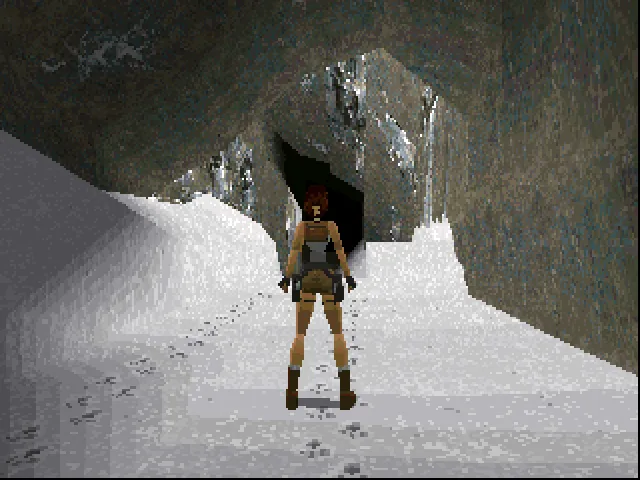
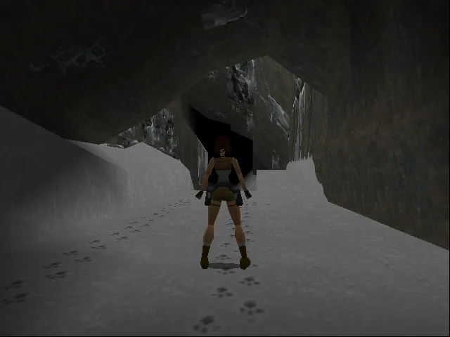
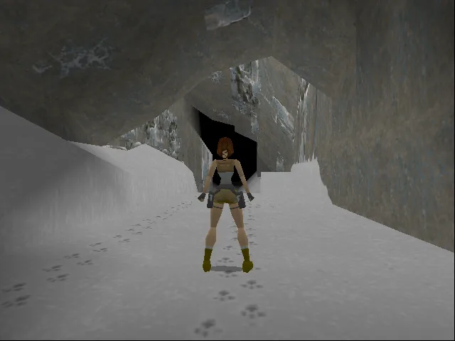
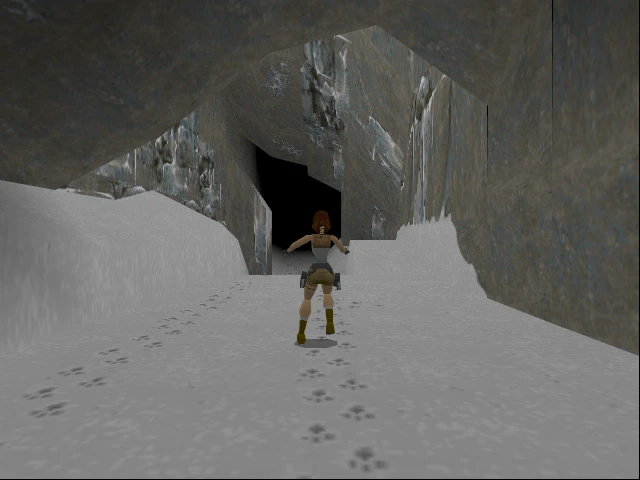
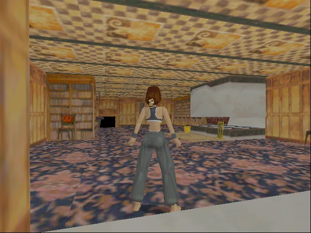
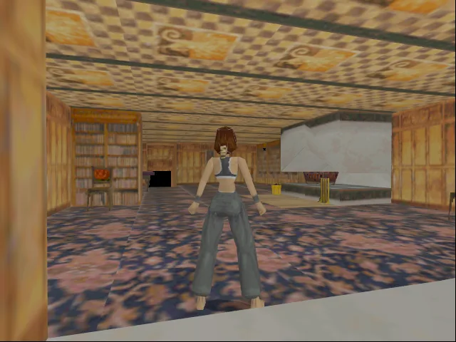

# Tomb Raider (1996 — 3dfx DOS Rush Patch)

| Field | Value |
| :--- | :--- |
| **Category** | Commercial Game |
| **Year** | 1996 (3dfx Rush patch: June 1997) |
| **Platform(s)** | `DOS/32 (GLIDE2X.OVL via DOSBox Glide pass-through)` |
| **Glide API & Version** | Glide 2.x (`2.48` on Voodoo Graphics / `2.56` on Voodoo2) |
| **Recommended Card Profile** | `VoodooGraphics` (authentic SST-1) · `Voodoo2` (for enhanced preset) |
| **Verified Backends** | Vulkan · OpenGL ES · Software (AVX2 / AVX-512 / Scalar) |
| **Preset File(s)** | [`glide-ng.ini`](./glide-ng.ini) (Recommended SST-1) · [`glide-ng.hq.ini`](./glide-ng.hq.ini) (4× MSAA + No-Dither) · [`glide-ng.software.ini`](./glide-ng.software.ini) (CPU Software) |
| **Frame Pacing** | `30 FPS` (internal engine cap) |
| **Status** | Verified |

---

## Overview

Core Design's 1996 action-adventure landmark *Tomb Raider* received official DOS 3dfx patches in 1997 adding 640×480 perspective-correct texture mapping, W-buffer depth sorting (including near-plane `oow > 1.0` geometry), 8-bit palettized (`GR_TEXFMT_P_8`) textures with persistent palettes across `guTexMemReset()`, optional mipmapping, and line-drawn HUD gauges (`grDrawLine` with depth bias for Lara's health/oxygen bars).

---

## Editions, Patches & Executables

All three official DOS releases ship with the default filename **`TOMB.EXE`** (differentiated by patch date, binary size, and Glide linkage; some distributions or users rename them to keep multiple builds side by side):

| Patch / Build (`TOMB.EXE`) | Renderer | Works with `glide-ng`? | Notes |
| :--- | :--- | :---: | :--- |
| **3dfx Voodoo Rush patch** *(Jun 1997, ~874 KB)* | Glide 2.x (`GLIDE2X.OVL`) | **Yes (Recommended)** | Dynamically loads `GLIDE2X.OVL` at runtime, making it the required build for DOSBox Glide pass-through + `glide-ng`. Despite the "Rush" patch name, it runs cleanly on `VoodooGraphics` (SST-1) and `Voodoo2` profiles. |
| **Early 3dfx Glide 2.11 patch** *(Feb 1997, `TR_3DFX.211`, ~1.14 MB)* | Statically linked Glide 2.11 | No *(SW Voodoo only)* | Links Glide 2.11 statically inside `TOMB.EXE` and probes SST-1 PCI registers directly — never loads `GLIDE2X.OVL`. Usable only with low-level SST-1 software Voodoo emulation. |
| **Original DOS release** *(1996, ~769 KB)* | Pure DOS Software VGA (`320×200`) | No | Software VGA renderer; does not use Glide. |

---

## Recommended DOSBox Configurations

Keep the DOSBox configuration minimal — only non-default overrides are shown below.

The commands below assume `glide-ng`'s `libglide2x.so` is installed system-wide (if running directly from a local build directory instead of a system package, prepend `LD_LIBRARY_PATH=/path/to/glide-ng/lib`; see [Building & Installing](../../../user-guide/building-and-installing.md)). Place the DOSBox HLE pass-through `GLIDE2X.OVL` either in `TOMBRAID\` or in a directory listed on DOS `PATH`.

### Option A: Patched DOSBox-SVN (Glide Pass-Through → `glide-ng`) *(Recommended)*

```ini
# dosbox-svn.conf (minimal overrides)
[sdl]
# Avoids SDL_UpdateRects SIGSEGV under sdl12-compat -> sdl2-compat -> SDL3 on modern Linux
output = opengl

[cpu]
cycles = max

[glide]
glide = true
```

Launch with the game CD image mounted on `D:` and the Jun 1997 3dfx Rush-patched `TOMB.EXE`:

```bash
GLIDE_NG_CONFIG=/path/to/glide-ng.ini \
  dosbox -conf dosbox-svn.conf \
  -c "imgmount D /path/to/tomb_raider.cue -t iso" \
  -c "mount C /path/to/TombRaider" \
  -c "C:" \
  -c "cd TOMBRAID" \
  -c "TOMB.EXE"
```

*(If your pass-through `GLIDE2X.OVL` lives in a separate DOS directory rather than `TOMBRAID\`, add it to `PATH`, e.g. `-c "SET PATH=C:\GLIDE;%PATH%"`.)*

### Option B: DOSBox-X (Glide Pass-Through → `glide-ng`)

```ini
# dosbox-x-pass.conf (minimal overrides)
[cpu]
cycles = max

[voodoo]
glide = true
lfb = full
```

Launch with the HLE pass-through `GLIDE2X.OVL` in `TOMBRAID\` or on DOS `PATH`:

```bash
GLIDE_NG_CONFIG=/path/to/glide-ng.ini \
  dosbox-x -conf dosbox-x-pass.conf -nopromptfolder \
  -c "imgmount D /path/to/tomb_raider.cue -t iso" \
  -c "mount C /path/to/TombRaider" \
  -c "C:" \
  -c "cd TOMBRAID" \
  -c "TOMB.EXE"
```

### Option C: Enhanced Visuals (`glide-ng.hq.ini` + In-Game `Normal` Detail)

Use [`glide-ng.hq.ini`](./glide-ng.hq.ini) (`msaa = 4`, `presentation_filter = nearest`, `no_dither_sub = true`) on either DOSBox-SVN (Option A) or DOSBox-X (Option B), keeping the in-game Ring Menu → **Detail Levels** on **`Normal`** for sharp textures and seamless floors:

```bash
GLIDE_NG_CONFIG=/path/to/glide-ng.hq.ini \
  dosbox -conf dosbox-svn.conf \
  -c "imgmount D /path/to/tomb_raider.cue -t iso" \
  -c "mount C /path/to/TombRaider" \
  -c "C:" \
  -c "cd TOMBRAID" \
  -c "TOMB.EXE"
```

*(On CPU-only hosts, substitute [`glide-ng.software.ini`](./glide-ng.software.ini) with `GLIDE_NG_SW_AA=ssaa`.)*

### Reference Comparison: DOSBox-X Software Voodoo (No `glide-ng`)

If comparing against DOSBox-X's built-in low-level SST-1 software emulator:

```ini
# dosbox-x-sw.conf
[cpu]
cycles = max

[voodoo]
voodoo_card = software
glide = false
```

Software Voodoo emulates **Voodoo Graphics (SST-1)** and requires a real **SST-1** `GLIDE2X.OVL` — specifically **Glide 2.42 (SST-1)** (or `2.30`), *not* the Voodoo Rush OVL, *not* Voodoo2 (`2.5x`), *not* `2.43+`/`2.48`, and *not* the HLE pass-through OVL.

---

## Visual Progression Gallery

All captures below are `640×480` via patched DOSBox-SVN (Software `320×200` scaled nearest-neighbor to 4:3), progressing left-to-right, top-to-bottom from DOS software up to Best Visuals:

| | |
| :---: | :---: |
| <br>**1. Caves — DOS Software (`320×200`, original `TOMB.EXE`)**<br>Unfiltered pixel-art cave walls, coarse banded snowbanks, and chunky polygon edges. | <br>**2. Caves — 3dfx Dark / Modern LCD (`gamma = 1.0`)**<br>`640×480` bilinear filtering with flat `1.0` gamma (matching wrappers/emulators that omit RAMDAC gamma), producing deeper shadows and higher cave contrast. |
| <br>**3. Caves — 3dfx Authentic SST-1 ([`glide-ng.ini`](./glide-ng.ini), native `1.5` gamma, `1×`, `Normal`)**<br>Uses `TOMB.EXE`'s native `grGammaCorrectionValue(1.5)` for balanced cave visibility with seamless snow floors and crisp rock detail; diagonal silhouettes remain `1×` aliased. | <br>**4. Caves — 3dfx Enhanced Visuals ([`glide-ng.hq.ini`](./glide-ng.hq.ini), `4×` MSAA, `Normal`)**<br>`4×` Vulkan MSAA smooths Lara's silhouette and cave ridges while `no_dither_sub = true` cleans up gradients, keeping walls sharp and floors completely free of atlas mipmap seams. |
| <br>**5. Croft Manor — Standard (`1×`, `Normal` detail)**<br>Crisp close-up textures with zero atlas seams; distant checkered ceilings and carpets show natural non-mipmapped aliasing. | <br>**6. Croft Manor — Optional In-Game `Mipmapping` (`4×` MSAA)**<br>Enabling in-game `Mipmapping` reduces distant ceiling and carpet shimmering at the trade-off of softer oblique walls and visible atlas seams on packed floor tiles. |

---

## Visual Quality & Performance Tuning

### Mipmapping vs. Normal (In-Game Detail Levels)
* Keep the Ring Menu → **Detail Levels** set to **`Normal`** *(Recommended)* for the sharpest textures and seamless floors.
* **Why `Mipmapping` introduces visible tile seams in *Tomb Raider*:** Core Design's engine packs `64×64` level textures into shared `256×256` texture atlases and insets polygon UVs by `+0.5` texels at mip level 0 (`256×256`). At mip 0 (`Normal`), bilinear filtering stays strictly inside each `64×64` tile with zero neighbor bleed. When in-game `Mipmapping` is enabled, mip level 1 (`128×128`) and mip level 2 (`64×64`) shrink that `+0.5` texel margin to `0.25` and `0.125` texels, causing bilinear sampling to bleed adjacent dark tiles from the same atlas across snow floors and wall seams. This exact seam behavior occurs on authentic 3dfx SST-1 silicon and DOSBox-X's register-level software Voodoo emulator; some older wrappers (such as OpenGlide) hide it only because they disable mipmapping by default.
* **Why `force_trilinear` is omitted from `glide-ng.hq.ini`:** Setting `force_trilinear = true` overrides `grTexFilterMode` on *Tomb Raider*'s explicitly point-sampled HUD/menu font atlas (softening menu labels) and forces mipmapping onto packed world atlases even when in-game Detail Levels is set to `Normal`.

### Anti-Aliasing & Presentation Scaling
* *Tomb Raider* has **no built-in anti-aliasing option** (Detail Levels only toggles `Normal` vs. `Mipmapping`).
* **Vulkan / OpenGL ES:** Use [`glide-ng.hq.ini`](./glide-ng.hq.ini) (`msaa = 4`, `presentation_filter = nearest`, `no_dither_sub = true`) to smooth 3D polygon silhouettes while keeping point-sampled UI/menu text razor-sharp at high host resolutions. Set `presentation_filter = linear` if softer upscaling is preferred on non-integer display ratios.
* **Software backend:** Add `GLIDE_NG_SW_AA=ssaa` (`[software] aa = ssaa`) for 2×2 supersampling.

### Gamma / Brightness
* `TOMB.EXE` natively calls `grGammaCorrectionValue(1.5)` at startup, smoothly steps gamma down during fade-out transitions, and provides an in-game **Ring Menu → Gamma** adjustment.
* All presets leave `[glide] gamma` unset by default so native `1.5` gamma, smooth fades, and the in-game Gamma slider all function normally.
* **Darker modern-LCD look:** Wrappers and emulators that do not apply RAMDAC gamma (such as OpenGlide under Wayland or DOSBox-X software Voodoo) display effective `gamma = 1.0`. To match that darker look, either lower the in-game Gamma setting or uncomment `gamma = 1.0` in the preset (or launch with `SST_GAMMA=1.0`). Note that an explicit `[glide] gamma` override locks gamma to a fixed value and overrides in-game fades and the Gamma slider.

### Speed & Backend Selection
* **GPU hosts:** `backend = vulkan` (or `opengl_es`) easily sustains the game's locked **`30 FPS`** internal engine cadence even with `msaa = 4`.
* **CPU-only hosts / VMs:** [`glide-ng.software.ini`](./glide-ng.software.ini) (`backend = software`, `simd = auto`) uses `glide-ng`'s multi-threaded AVX2/AVX-512 tiled rasterizer, which runs **5.5×–10.1× faster** in wall-clock FPS than DOSBox-X's synchronous software Voodoo emulation across the 9-scene `glide_bench` suite.

---

## Quirks, Known Issues & Controls

### Engine Notes & Quirks
* **Occasional dynamic 1 px vertical black cracks between wall sections:** Core Design's 1996 engine projects all room vertices to integer screen coordinates and clips room portals on integer pixel boundaries, leaving genuine 1-pixel vertical gaps in the submitted Glide vertex stream. These exact same vertical cracks occur on authentic 3dfx SST-1 hardware and DOSBox-X software Voodoo. Enabling `presentation_filter = linear` softens them visually at the cost of softer UI text.
* **Startup splash:** `glide-ng` plays its procedural startup splash once automatically on `grSstWinOpen()` (matching authentic 3dfx Glide). Set `no_splash = true` in `glide-ng.ini` (or `FX_GLIDE_NO_SPLASH=1`) to skip straight to the intro.
* **DOSBox-SVN `output = opengl` on Linux:** On distributions routing SDL 1.2 through `sdl12-compat` → `sdl2-compat` → `SDL3`, DOSBox-SVN's default `surface` output can crash with a `SIGSEGV` in `SDL_UpdateRects()` during the VGA mode switches of the intro FMVs. Setting `[sdl] output = opengl` avoids this code path.

### Useful Controls
* `Arrow keys` — Move / Turn · `Shift` — Walk (no ledge drop) · `Alt` — Jump · `Ctrl` — Action / Fire · `Space` — Draw / Holster weapons · `Esc` — Ring Menu / Inventory · `F1`–`F6` — Quick menu shortcuts
