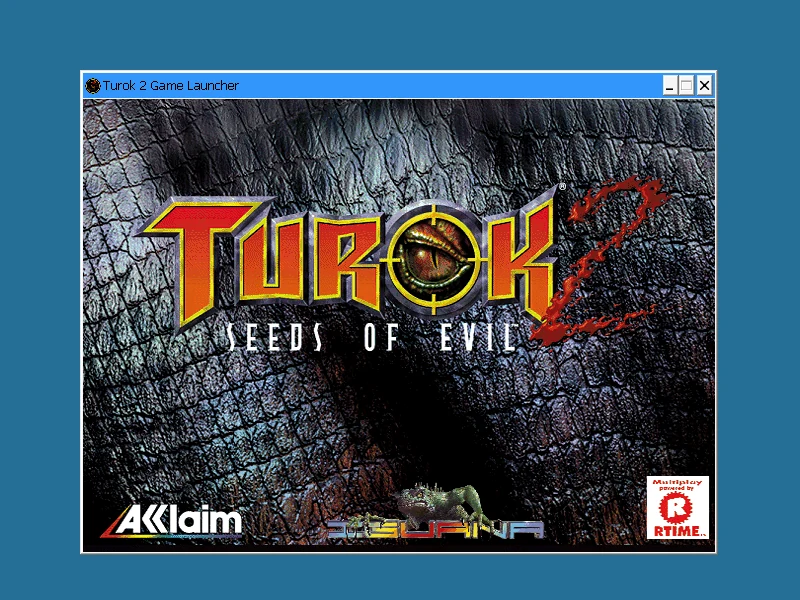
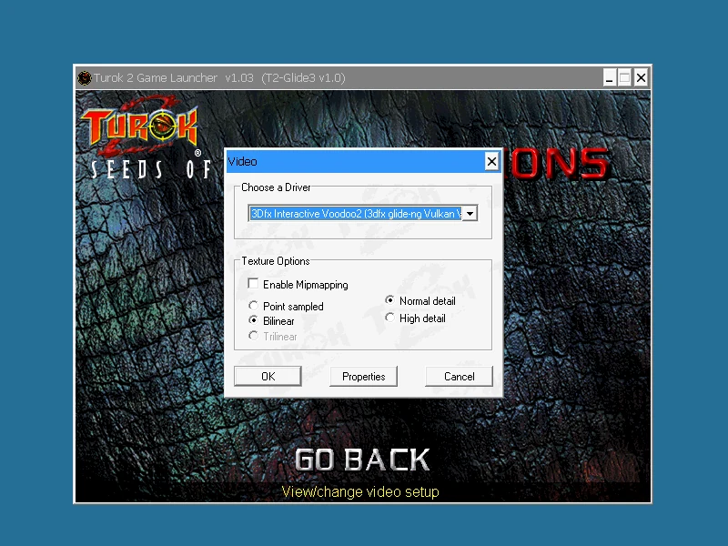
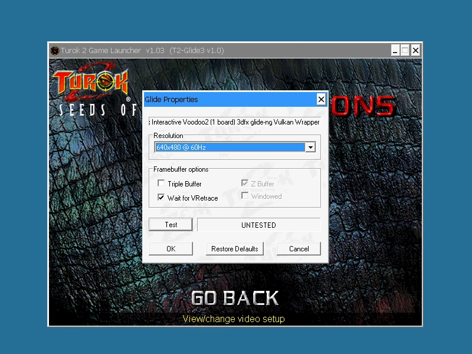
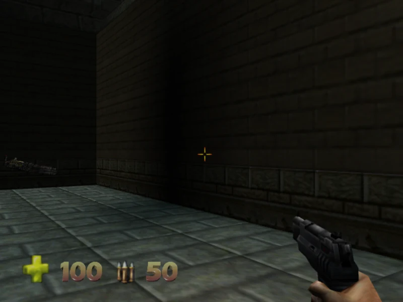
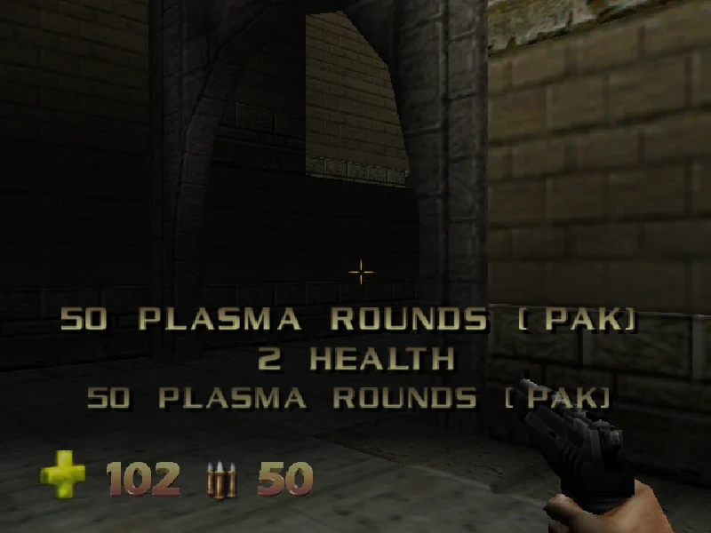
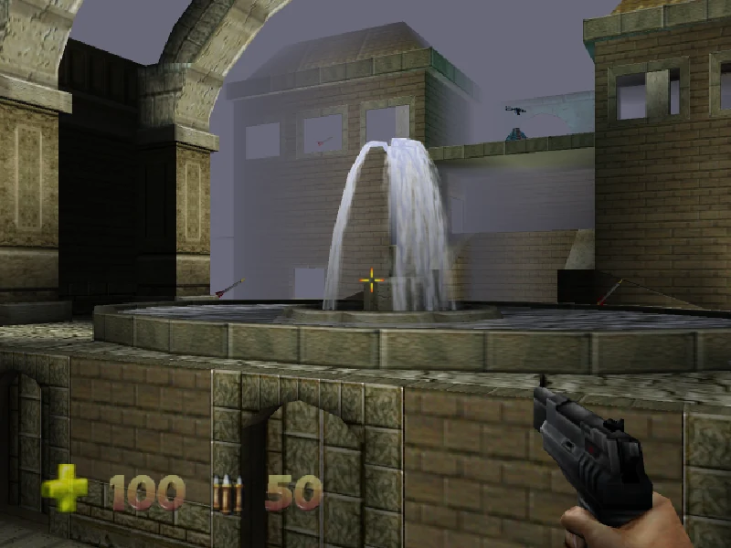

# Turok 2: Seeds of Evil (1999 — Win32 3dfx Glide 3.x)

| Field | Value |
| :--- | :--- |
| **Category** | Commercial Game |
| **Year** | 1999 *(Acclaim / Iguana Entertainment PC port)* |
| **Platform(s)** | `Win32 / Wine (glide3x.dll)` |
| **Glide API & Version** | **Glide 3.x (`glide3x.dll`, Voodoo2 `3.03` / Voodoo3 `3.10`)** |
| **Recommended Card Profile** | `Voodoo2` (`3.03`) · `Voodoo3` (`3.10`) |
| **Verified Backends** | Vulkan · OpenGL 3.3 Core (WGL) · Software (AVX2 / AVX-512 / Scalar) |
| **Preset File(s)** | [`glide-ng.ini`](./glide-ng.ini) (`1×`, Vulkan) · [`glide-ng.hq.ini`](./glide-ng.hq.ini) (`4× MSAA` + Linear, recommended) · [`glide-ng.voodoo3.ini`](./glide-ng.voodoo3.ini) (Voodoo3 `3.10`) · [`glide-ng.software.ini`](./glide-ng.software.ini) (CPU Software `2×2 SSAA`) |
| **Status** | Verified |

---

## Overview

Iguana Entertainment's PC edition of *Turok 2: Seeds of Evil* pairs a Win32 bitmap launcher (`Turok2.exe` single-player / `Turok2MP.exe` multiplayer `v1.03`+) with a pluggable rendering subsystem supporting **`Video_3DFx.dll` (T2-Glide3 `v1.0`, `glide3x.dll`)** and **`Video_D3D.dll` (Direct3D 6)**.

In Glide 3.x mode, **`Video_3DFx.dll`** renders with **`GR_ORIGIN_LOWER_LEFT` (`Origin=1`)**, an inverted 16-bit Z-buffer (**`GR_DEPTHBUFFER_ZBUFFER`**, **`GR_CMP_GEQUAL`**), bilinear-filtered light/fog surfaces, volumetric alpha-blended particles (water fountain jets, plasma projectiles, explosions), distance **`GR_FOG_WITH_TABLE`** atmospheric haze, and semi-transparent colored HUD numerals and pickup banners.

Under **`glide-ng`**, **`Turok2MP.exe`** auto-detects **`glide3x.dll`** cleanly via `Video_3DFx.dll` on both **`Voodoo2` (`3.03`)** and **`Voodoo3` (`3.10`)** profiles across **Vulkan** (`1×` and **`4× MSAA`**), **OpenGL 3.3 Core (WGL)**, and **CPU Software AVX2 (`2×2 SSAA`)**, avoiding the unenumerated `"Unknown card"` fallback seen under Wine's `Video_D3D.dll` driver probe.

---

## Editions, Patches & Executables

| Binary / Renderer | Graphics API | Works with `glide-ng`? | Technical Notes |
| :--- | :--- | :---: | :--- |
| **`Turok2MP.exe` + `Video_3DFx.dll`** (`v1.03` / `v1.04`) | **Glide 3.x (`glide3x.dll`)** | **Yes (Recommended)** | Dedicated multiplayer / solo-host launcher (`LAN → HOST A GAME → START GAME`). Does **not** require a physical Red Book CD audio TOC check. Auto-detects `3Dfx Interactive Voodoo2`/`Voodoo3` (`T2-Glide3 v1.0`). |
| **`Turok2.exe` + `Video_3DFx.dll`** | **Glide 3.x (`glide3x.dll`)** | **Yes** *(CD audio required)* | Single-player campaign executable sharing the same `Video_3DFx.dll` renderer. Performs an MCI Red Book CD-audio check at startup (`"Turok CD Not Found!"` if mounted only as a directory tree without audio tracks). |
| **`Video_D3D.dll`** | Direct3D 6 | No *(Comparison baseline)* | On Wine, `Video_D3D.dll` reports `Unknown card -- Select from list below` (`_Unlisted D3D Card`). Requires renaming/switching via `Video` setup dialog (`data/config.ned`). |
| **`Video_MM.dll`** *(from v2.1 update)* | Direct3D / Glide helper stub | Optional | Updated companion video stub module shipped with the *Turok 2* v2.1 patch. |

> **Multiplayer levels (`data/*.lsm`):** On manual InstallShield `data1.cab` unpacks, verify the `.lsm` multiplayer level sets (and single-player `Seeds of Evil.lss`) are accessible inside `data/` alongside `Levels/`, otherwise **`Turok2MP.exe`** displays `"no Multi-player Level Set (.lsm) files installed"`.

---

## Recommended Launch Configurations (Wine32 / Windows)

Install the base disc, place **`glide-ng`'s** Win32 **`glide3x.dll`** inside the **`Turok2`** folder next to **`Turok2.exe`** / **`Turok2MP.exe`**, and map the CD drive if launching single-player.

### One-Time Wine Prefix & Driver Reset

```bash
WINEARCH=win32 WINEPREFIX=/path/to/prefix wineboot -u
WINEARCH=win32 WINEPREFIX=/path/to/prefix wine reg add \
  'HKCU\Software\Wine' /v Version /t REG_SZ /d win98 /f

# Optional: truncate data/config.ned whenever switching card/backend profile
# so the launcher auto-detects the active Video_3DFx.dll renderer string:
: > /path/to/Turok2/data/config.ned
```

> **Sticky `data/config.ned`:** *Turok 2* caches the selected `GR_HARDWARE` string verbatim inside `data/config.ned` (`Acclaim\Turok\Driver ...`). If you switch between `Vulkan`, `OpenGL`, `Software`, or between `Voodoo2` and `Voodoo3`, clear `data/config.ned` (0 bytes) so the launcher picks up the newly active `Video_3DFx.dll` driver automatically.

### Option A: Best Visuals — Vulkan `4× MSAA` (`glide-ng.hq.ini`) *(Recommended)*

```bash
WINEARCH=win32 WINEPREFIX=/path/to/prefix \
WINEDLLOVERRIDES="glide3x=n" \
GLIDE_NG_CONFIG=/path/to/glide-ng.hq.ini \
  wine explorer /desktop=T2,800x600 Turok2MP.exe
```

On CPU-only Vulkan hosts (`llvmpipe`), add `LP_NUM_THREADS=4` to conserve 32-bit Wine virtual address space.

### Option B: Native Vulkan `1×` (`glide-ng.ini`)

```bash
WINEARCH=win32 WINEPREFIX=/path/to/prefix \
WINEDLLOVERRIDES="glide3x=n" \
GLIDE_NG_CONFIG=/path/to/glide-ng.ini \
  wine explorer /desktop=T2,800x600 Turok2MP.exe
```

### Option C: Voodoo3 Profile (`glide-ng.voodoo3.ini`)

```bash
WINEARCH=win32 WINEPREFIX=/path/to/prefix \
WINEDLLOVERRIDES="glide3x=n" \
GLIDE_NG_CONFIG=/path/to/glide-ng.voodoo3.ini \
  wine explorer /desktop=T2,800x600 Turok2MP.exe
```

### Option D: OpenGL 3.3 Core (WGL)

```bash
WINEARCH=win32 WINEPREFIX=/path/to/prefix \
WINEDLLOVERRIDES="glide3x=n" GLIDE_NG_BACKEND=opengl_es \
  wine explorer /desktop=T2,800x600 Turok2MP.exe
```

### Option E: CPU Software Rasterizer (`glide-ng.software.ini` — `2×2 SSAA`)

```bash
WINEARCH=win32 WINEPREFIX=/path/to/prefix \
WINEDLLOVERRIDES="glide3x=n" GLIDE_NG_CONFIG=/path/to/glide-ng.software.ini \
  wine explorer /desktop=T2,800x600 Turok2MP.exe
```

---

## Visual Progression Gallery

All captures below are from **`Turok2MP.exe`** (`v1.03`, `T2-Glide3 v1.0`, `Harbor-9` arena via `LAN → HOST A GAME → START GAME`) running in Wine32 at `640×480` scaled inside an `800×600` virtual desktop:

| | |
| :---: | :---: |
| <br>**1. Turok 2 Game Launcher Splash**<br>Retail Win32 launcher screen displayed before the video menu and arena host panel. | <br>**2. Video Driver Setup (`Video_3DFx.dll`)**<br>Auto-detects **`3Dfx Interactive Voodoo2 (3dfx glide-ng Vulkan Wrapper)`** with Bilinear texture filtering enabled. |
| <br>**3. `Glide Properties` (`T2-Glide3 v1.0`)**<br>Mode setup showing **`640×480 @ 60Hz`**, **`Z Buffer`**, **`Wait for VRetrace`**, and optional **`Triple Buffer`**. | <br>**4. Glide 3.x — Vulkan `4× MSAA` (`glide-ng.hq.ini`)**<br>`Harbor-9` indoor brick corridor showing smooth perspective-correct tiled flooring, crisp weapon model, Shredder pickup on the left, crosshair, and transparent HUD counters. |
| <br>**5. Glide 3.x — OpenGL 3.3 Core (WGL)**<br>Archway courtyard entry showing crisp translucent pickup overlays (`50 PLASMA ROUNDS [PAK]`, `2 HEALTH`), warm brick lighting, and matching depth occlusion. | <br>**6. Glide 3.x — CPU Software AVX2 (`2×2 SSAA`)**<br>Outdoor `Harbor-9` courtyard fountain showing smooth alpha-blended cascading water jets, atmospheric `GR_FOG_WITH_TABLE` haze, elevated balcony weapon pickup, and clean lower-left origin alignment. |

---

## Visual Quality & Performance Tuning

* **Resolution & Anti-Aliasing:** Set your preferred Glide mode (`640×480`, `800×600`, or higher on **`Voodoo3`**) inside **Options → Video → Properties** in the launcher. **`4× MSAA`** (`glide-ng.hq.ini`) cleanly smooths archways, diagonal stone borders, and view-model edges with zero texture bleeding.
* **Bilinear & Mipmapping:** In the **Video** dialog, keep **Bilinear** selected; enable **Enable Mipmapping** + **High detail** if using a hardware Vulkan/OpenGL GPU for sharper distant wall masonry.
* **Single-Player vs. Multiplayer Engine:** Both `Turok2.exe` and `Turok2MP.exe` invoke the identical **`Video_3DFx.dll`** driver and Glide 3.x pipeline. Any preset validated on `Turok2MP.exe` applies unchanged to `Turok2.exe`.

---

## Quirks, Known Issues & Controls

### Installation & Disc Notes
* **Single-player Red Book CD audio check (`Turok2.exe`):** The retail `Turok2.exe` queries MCI Red Book CD-audio tracks from the mounted optical drive at launch. Running inside a Wine directory-only drive link triggers `"Turok CD Not Found!"` unless the full mixed-mode CD image (`.mds`/`.mdf` or physical disc containing the audio tracks) is mounted as a real optical block device (`cdemu` / Windows virtual drive).
* **Launcher `.lsm` level-set discovery:** Ensure `Levels/*.lsm` (and `Levels/*.lss` for single-player) are copied or symlinked into `data/` if unpacking `data1.cab` manually outside InstallShield.
* **Playing solo in `Turok2MP.exe`:** From the launcher select **`PLAY` → `LAN` → `HOST A GAME` → `START GAME`** to enter the `Harbor-9` courtyard arena directly with zero external server required.

### Useful Controls

| Action | Key |
| :--- | :--- |
| **Move Forward / Back / Strafe** | `W` / `S` / `A` / `D` *(or Arrow keys)* |
| **Fire Primary Weapon** | `Left Click` / `Ctrl` |
| **Jump** | `Space` |
| **Switch Weapons** | `1`–`9` / Mouse Wheel |
| **In-Game Options / Quit Match** | `Esc` |
