# Unreal (1998 — Win32 3dfx Glide 2.x)

| Field | Value |
| :--- | :--- |
| **Category** | Commercial Game |
| **Year** | 1998 |
| **Platform(s)** | `Win32 / Wine (glide2x.dll)` |
| **Glide API & Version** | Glide 2.x (`2.56` on Voodoo2 / `2.48` on Voodoo Graphics SST-1) |
| **Recommended Card Profile** | `Voodoo2` (default, dual-TMU `800×600`) · `VoodooGraphics` (`2.48`, single-TMU `640×480`) |
| **Verified Backends** | Vulkan · OpenGL 3.3 Core (WGL) · Software (AVX2 / AVX-512 / Scalar) |
| **Preset File(s)** | [`glide-ng.ini`](./glide-ng.ini) (Voodoo2) · [`glide-ng.hq.ini`](./glide-ng.hq.ini) (4× MSAA + Linear) · [`glide-ng.voodoo1.ini`](./glide-ng.voodoo1.ini) (Voodoo1 SST-1) · [`glide-ng.software.ini`](./glide-ng.software.ini) (CPU Software) |
| **Status** | Verified |

---

## Overview

Epic MegaGames and Digital Extremes' landmark 1998 first-person shooter *Unreal* runs on **Unreal Engine 1**, originally designed around **3dfx Glide 2.x** (`GlideDrv.dll` → `glide2x.dll`). Features including detail textures, multi-pass modulated dynamic lightmaps (`RGB565` / `ARGB1555` / `P_8`), volumetric atmospheric fog, planar shiny marble reflections, procedural `Fire.dll` fractal water and cloud textures, colored torch lighting, and additive coronas are all natively supported via `GlideDrv.GlideRenderDevice`.

Technically, `GlideDrv.dll` mixes static paletted/16-bit world textures with tightly packed dynamic lightmaps and animated fractal surfaces streamed via `grTexDownloadMipMapLevelPartial`, dual-TMU lightmap compositing on `Voodoo2` (and multipass single-TMU fallback on `VoodooGraphics`), and live RAMDAC gamma via `grGammaCorrectionValue`.

---

## Editions, Patches & Executables

| Executable / Renderer | Graphics API | Works with `glide-ng`? | Technical Notes |
| :--- | :--- | :---: | :--- |
| **`Unreal.exe` (v226f Final) + `GlideDrv.dll`** | **Glide 2.x (`glide2x.dll`)** | **Yes (Recommended)** | Official Epic Games *Unreal Patch 226 Final*. Removes the retail startup log window, updates `GlideDrv.dll` stability, adds `D3DDrv.dll` / `OpenGlDrv.dll`, and supports clean `800×600` (`Voodoo2`) and `640×480` (`Voodoo1`) play with mirror floors, detail textures, and flickering dynamic lights. |
| **`Unreal.exe` (Retail v200, May 1998) + `GlideDrv.dll`** | Glide 2.x (`glide2x.dll`) | Yes *(Alternate)* | Unpatched retail CD installation. Runs cleanly with `glide2x.dll` once `CdPath=..\` is configured in `Unreal.ini`. |
| **OldUnreal `v227i` community patch** *(optional)* | Glide 2.x / OpenGL / D3D9 / XOpenGL | Optional | Maintained fan update with modern audio and high-res renderers; classic `GlideDrv.dll` remains selectable if desired. |
| **`SoftDrv.SoftwareRenderDevice` (`SoftDrv.dll`)** | CPU Software (16-bit) | No *(Comparison baseline)* | Epic's built-in software rasterizer. Unfiltered point-sampled textures with coarse shading and flat, muted torch flame halos. |
| **`D3DDrv.D3DRenderDevice` (`D3DDrv.dll`)** | Direct3D 6/7 | No *(Comparison baseline)* | Official v226f Direct3D driver (via Wine `wined3d`). Renders darker with shadow crush and clips the right `224 px` strip of a `1024×768` window under Wine. |
| **`OpenGLDrv.OpenGLRenderDevice` (`OpenGlDrv.dll`)** | OpenGL 1.x | No *(Crashes on Mesa)* | Stock 1999 experimental OpenGL driver crashes at startup inside `appSprintf` when printing modern `glGetString(GL_EXTENSIONS)` strings (even with `MESA_EXTENSION_MAX_YEAR=1999`). |

---

## Recommended Launch Configurations (Wine32 / Windows)

Copy `glide-ng`'s 32-bit **`glide2x.dll`** into the game's **`System/`** directory (next to `Unreal.exe`). Edit **`System/Unreal.ini`** to disable the CD check (after installing all assets to disk) and enable `GlideDrv.GlideRenderDevice`:

```ini
[FirstRun]
FirstRun=226

[Engine.Engine]
CdPath=..\
GameRenderDevice=GlideDrv.GlideRenderDevice
RenderDevice=GlideDrv.GlideRenderDevice

[Core.System]
CdPath=..\

[WinDrv.WindowsClient]
FullscreenViewportX=800
FullscreenViewportY=600
StartupFullscreen=True
Brightness=0.500000

[GlideDrv.GlideRenderDevice]
Translucency=True
VolumetricLighting=True
ShinySurfaces=True
Coronas=True
HighDetailActors=True
DetailBias=-1.500000
RefreshRate=60Hz
DetailTextures=True
FastUglyRefresh=False
ScreenSmoothing=True
Resolution=Default
```

*(For unpatched retail `v200`, set `FirstRun=False` instead of `FirstRun=226`. For the `Voodoo1` single-TMU preset, set `FullscreenViewportX=640` and `FullscreenViewportY=480`.)*

### Option A: Standard Glide 2.x (`glide-ng.ini` — Vulkan `1×`, `nearest` Scaling)

```bash
cd /path/to/unreal/System
WINEDLLOVERRIDES="glide2x=n" \
GLIDE_NG_CONFIG=/path/to/glide-ng.ini \
  wine explorer /desktop=Unreal,1024x768 ./Unreal.exe
```

To test the Win32 WGL OpenGL 3.3 Core backend instead of Vulkan, add `GLIDE_NG_BACKEND=opengl_es`. To launch without a Wine virtual desktop on X11/Wayland, run `wine ./Unreal.exe` directly. Append a map filename (e.g. `Bluff.unr` or `DmDeck16.unr`) to load directly into a level.

### Option B: Best Visuals (`glide-ng.hq.ini` — Vulkan `4× MSAA` + Linear) *(Recommended)*

```bash
cd /path/to/unreal/System
WINEDLLOVERRIDES="glide2x=n" \
GLIDE_NG_CONFIG=/path/to/glide-ng.hq.ini \
  wine explorer /desktop=Unreal,1024x768 ./Unreal.exe
```

### Option C: Authentic Voodoo Graphics (`glide-ng.voodoo1.ini` — Single-TMU, `640×480`)

```bash
cd /path/to/unreal/System
WINEDLLOVERRIDES="glide2x=n" \
GLIDE_NG_CONFIG=/path/to/glide-ng.voodoo1.ini \
  wine explorer /desktop=Unreal,800x600 ./Unreal.exe
```

### Option D: CPU Software Rasterizer (`glide-ng.software.ini` — AVX2 / AVX-512)

```bash
cd /path/to/unreal/System
WINEDLLOVERRIDES="glide2x=n" \
GLIDE_NG_CONFIG=/path/to/glide-ng.software.ini \
  wine explorer /desktop=Unreal,1024x768 ./Unreal.exe
```

---

## Visual Progression Gallery

All captures below show *Unreal* (`v226f` at `800×600`, plus retail `v200` and `VoodooGraphics` at `640×480`) across `Unreal.unr`, `NyLeve.unr`, `Vortex2.unr`, `DmDeck16.unr`, `DmTundra.unr`, and `Bluff.unr`, side by side with Epic's stock `SoftDrv.dll` and `D3DDrv.dll` renderers:

| | |
| :---: | :---: |
| <br>**1. Nali Castle Courtyard (`OpenGL / WGL`, `800×600`)**<br>Planar mirror marble floor reflecting twin blazing torch braziers, portcullis arch, banners, and turret roof cleanly. | <br>**2. Nali Castle Drawbridge (`Vulkan 4× MSAA` HQ, `800×600`)**<br>Crisp anti-aliased battlements, additive flame sparks, and bridge surface reflections under [`glide-ng.hq.ini`](./glide-ng.hq.ini). |
| 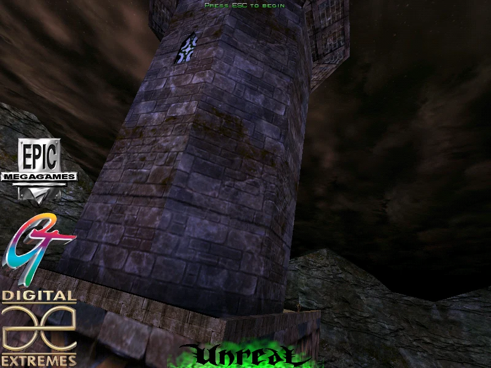<br>**3. Nali Castle Keep (`Vulkan 1×`, `Voodoo2 2.56`)**<br>Detail stone texture grain along the climbing tower framed against dark storm clouds and stars. | 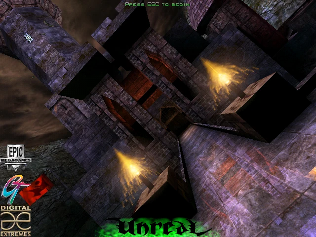<br>**4. Nali Castle (`VoodooGraphics` `2.48`, `640×480`)**<br>Single-TMU multipass mode (`1× 2 MB TMU`) matching dual-TMU dynamic lighting and banner transparency. |
| 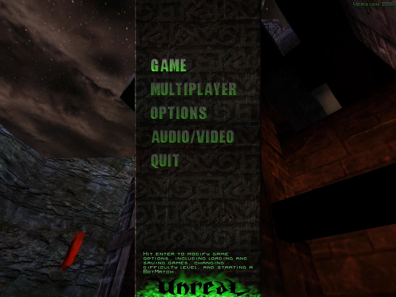<br>**5. Main Menu (`Software AVX2`, `v226f`)**<br>Embossed stone relief menu bar (`Esc`), translucent `VERSION 226` readout, and starry skybox. | 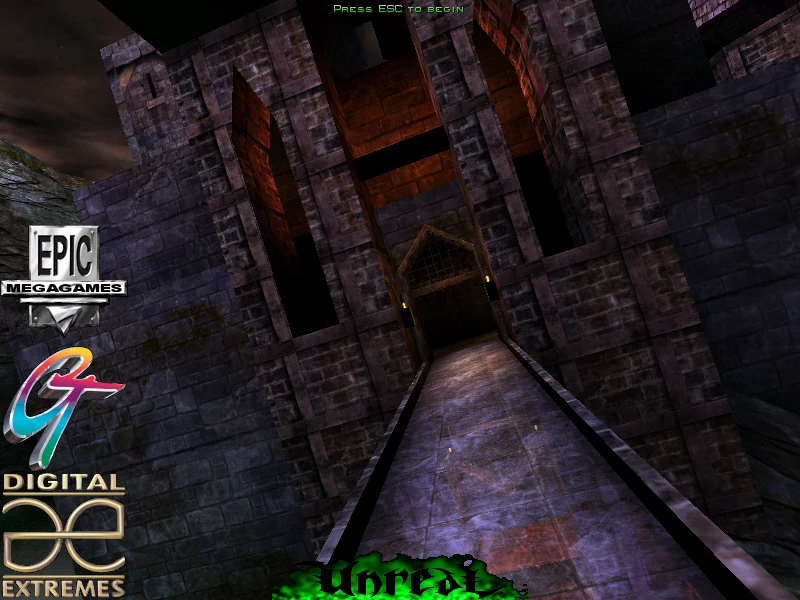<br>**6. Retail May 1998 `v200` (`Vulkan 1×`, `800×600`)**<br>Unpatched CD release verified running identically through `glide2x.dll` alongside `v226f`. |
| 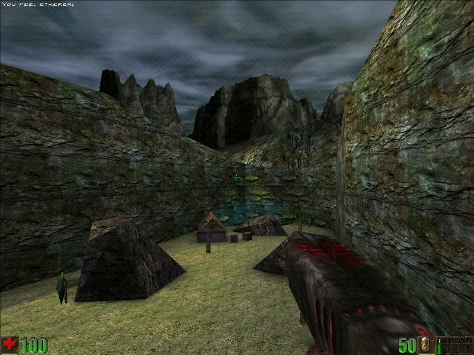<br>**7. *NyLeve's Falls* Valley (`Vulkan 4× MSAA` HQ)**<br>Outdoor Na Pali valley, mountain spires, stormy skybox, Nali hut, and layered ground detail textures. | 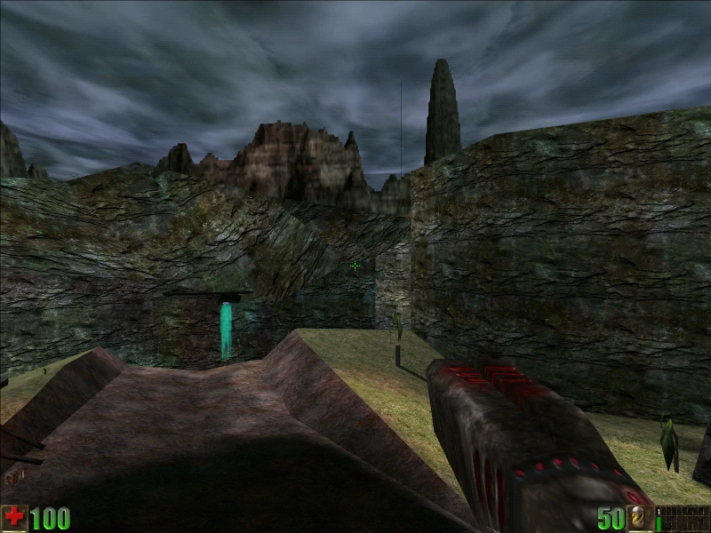<br>**8. *NyLeve's Falls* Waterfall (`Vulkan 4× MSAA` HQ)**<br>Turquoise glowing waterfall crest, cliff walls, and crisp volumetric horizon layering. |
| 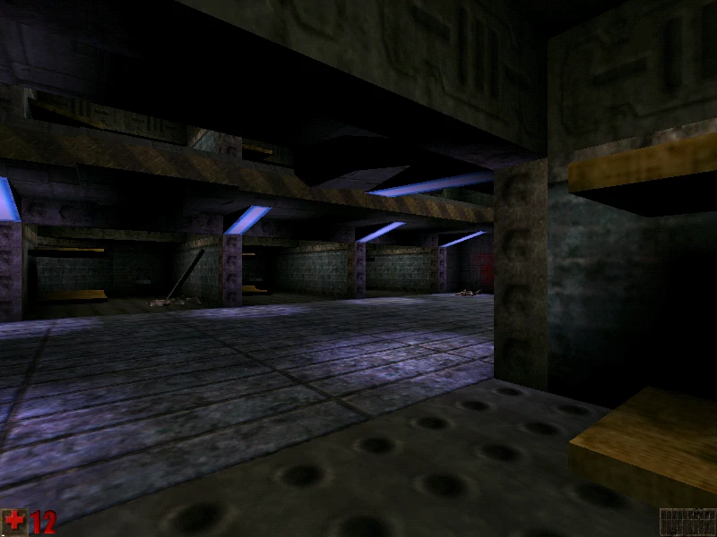<br>**9. *Vortex Rikers* (`Vortex2.unr`, `Vulkan 1×`)**<br>Crashed prison ship interior with cool blue fluorescent light reflections and red HUD telemetry. | <br>**10. *Vortex Rikers* (`Vortex2.unr`, `OpenGL / WGL`)**<br>Matching metallic floor reflections, cell shadows, and blue overhead fixture lighting. |
| <br>**11. *Vortex Rikers* (`Vortex2.unr`, `Software AVX2`)**<br>Full cross-backend parity on the AVX2/AVX-512 CPU rasterizer with `no_dither_sub = true`. | 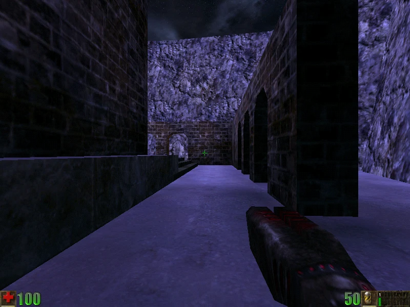<br>**12. *DM-Tundra* (`DmTundra.unr`, `Vulkan 1×`)**<br>Cool twilight arches, violet cliff lightmaps, and smooth starry sky dome. |
| 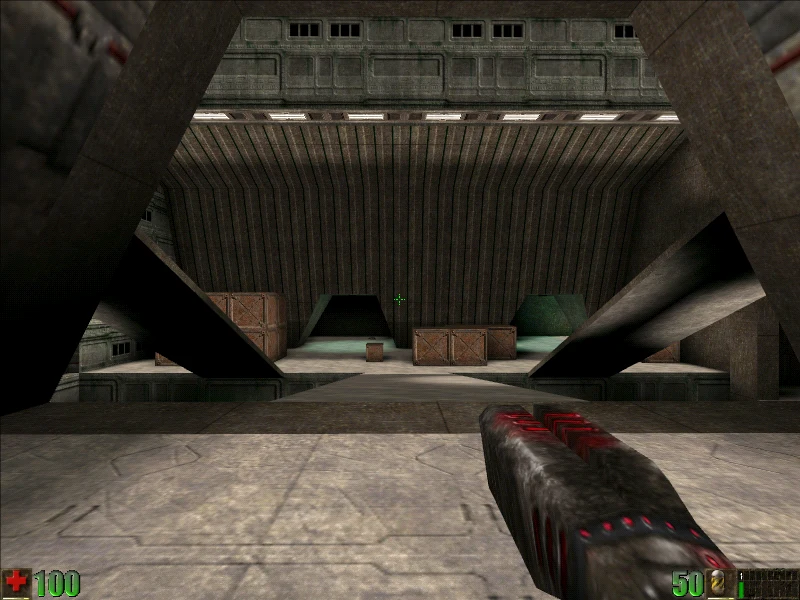<br>**13. *DM-Deck16* (`Vulkan 4× MSAA` HQ, `800×600`)**<br>Industrial arena ramp with anti-aliased edges, crate lighting, and green sludge glow from below. | 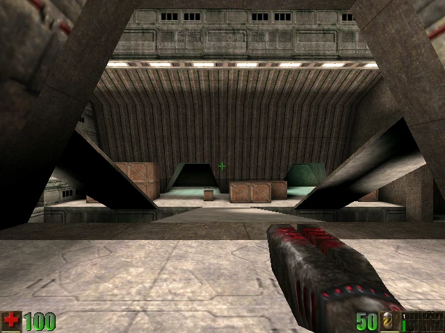<br>**14. *DM-Deck16* (`VoodooGraphics` `2.48`, `640×480`)**<br>Authentic single-TMU SST-1 profile ceiling preserving the exact lighting and silhouette balance. |
| <br>**15. *Bluff Eversmoking* — Glide `Vulkan 1×` ([`glide-ng.ini`](./glide-ng.ini))**<br>Warm torchlit stonework, cool emerald ambient wall glow, shiny floor reflections, and crisp Dispersion Pistol. | <br>**16. *Bluff Eversmoking* — Glide `4× MSAA` HQ ([`glide-ng.hq.ini`](./glide-ng.hq.ini))**<br>Smoothed arch and doorway edges with `4× MSAA` offscreen resolve and linear scaling. |
| 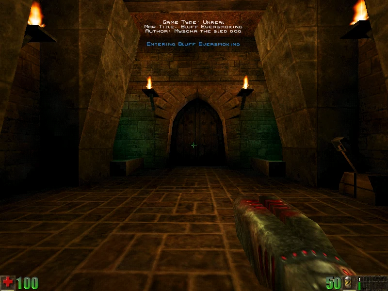<br>**17. *Bluff Eversmoking* — Glide `OpenGL / WGL`**<br>Vivid additive map title overlay (before fade-out) with identical flame and wall lighting. | 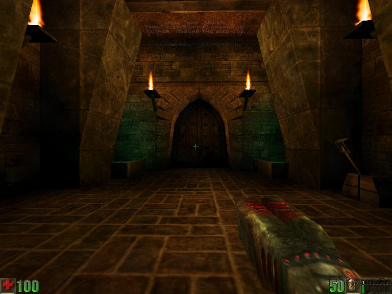<br>**18. *Bluff Eversmoking* — Glide `Software AVX2`**<br>CPU rasterizer matches GPU torch bounce glow, stone detail, and floor sheen seamlessly. |
| <br>**19. Reference: Stock `SoftDrv.dll` (16-bit CPU)**<br>Unfiltered nearest-neighbor texture sampling with noticeably flatter, duller orange flame sprites. | <br>**20. Reference: Stock `D3DDrv.dll` (Wine `wined3d`)**<br>Darker contrast crush plus a `224 px` dead black clip bar on the right inside a `1024×768` window under Wine. |

---

## Visual Quality & Performance Tuning

### Flavour Comparison: `GlideDrv.dll` vs. `SoftDrv.dll` vs. `D3DDrv.dll` vs. `OpenGlDrv.dll`
* **`GlideDrv.GlideRenderDevice` (`glide-ng` + [`glide-ng.hq.ini`](./glide-ng.hq.ini)) is the clear winner:** crisp bilinear & detail textures, accurate flickering flame halos, planar shiny reflections, unclipped `800×600` framing, `4× MSAA` edge smoothing, and full cross-backend parity.
* **`SoftDrv.dll` (16-bit CPU):** Reliable fallback for comparison, but point-sampled texels shimmer and torch fires look noticeably muted.
* **`D3DDrv.dll` (Direct3D 6/7 via `wined3d`):** Crushes shadows darker and leaves an unrendered `224 px` black right strip inside a `1024×768` container under Wine.
* **`OpenGlDrv.dll` (stock v226f):** Crashes during startup inside `appSprintf` on modern OpenGL extension strings.

### Gamma & Cache Tuning
* **Brightness / gamma:** Leave `[glide] gamma` unset in `glide-ng.ini` so *Unreal*'s in-game **`F11` / Brightness** slider (`grGammaCorrectionValue`, default `0.5` → `1.25`) operates cleanly.
* **Dynamic cache size:** Raising `[Engine.GameEngine] CacheSizeMegs=4` to **`16`** reduces surface cache churn in open levels such as *NyLeve's Falls* and *Bluff Eversmoking*.
* **Resolution selection:** Keep `[GlideDrv.GlideRenderDevice] Resolution=Default` so `FullscreenViewportX` / `FullscreenViewportY` take effect directly (`800×600` on `Voodoo2`, `640×480` on `VoodooGraphics`).

---

## Quirks, Known Issues & Controls

### Installation & Engine Notes
* **Keep `[display] fullscreen = false` (`GLIDE_NG_FULLSCREEN` unset):** *Unreal*'s `WinDrv.WindowsClient` owns its window bounds lifecycle. Triggering an extra resize inside `grSstWinOpen` causes a re-entrant `WM_SIZE` repaint before `FMemCache` completes initialization (`Assertion failed: Initialized [UnCache.cpp]`). Let `Unreal.ini`'s `StartupFullscreen=True` size the window instead.
* **Wine virtual desktop height:** When using `wine explorer /desktop=...` at `800×600`, keep the virtual desktop larger than the game viewport (`1024x768`) so the title bar does not clip ~22 px off the lower green `Unreal` logo.
* **No-CD asset path (`CdPath=..\`):** Both retail `v200` and patched `v226f` probe `Palettes.utx` beneath `CdPath`. Adding `CdPath=..\` under both `[Engine.Engine]` and `[Core.System]` allows disc-free startup when all assets live on disk.
* **Startup splash:** Uncomment `no_splash = true` in `glide-ng.ini` (or pass `FX_GLIDE_NO_SPLASH=1`) to skip the one-shot startup splash on launch.

### Useful Controls

| Key | Action |
| :--- | :--- |
| **`Esc`** | Open / close the main menu (`GAME / MULTIPLAYER / OPTIONS / AUDIO/VIDEO / QUIT`) |
| **`W` / `A` / `S` / `D`** or **Arrow keys** | Move / turn *(rebindable in `Options → Customize Controls`)* |
| **`Space`** / **`C`** | Jump / Crouch (ascend while using `fly` / `ghost`) |
| **`Left Click` / `Ctrl`** | Primary fire |
| **`Right Click` / `Alt`** | Alternate fire |
| **`Tab`** / **`~`** | Open quick command line / full console (`timedemo 1`, `fov 90`) |
| **`F11`** | Adjust brightness / gamma (`grGammaCorrectionValue`) |
| **`Alt + Enter`** | Toggle fullscreen / windowed viewport |
