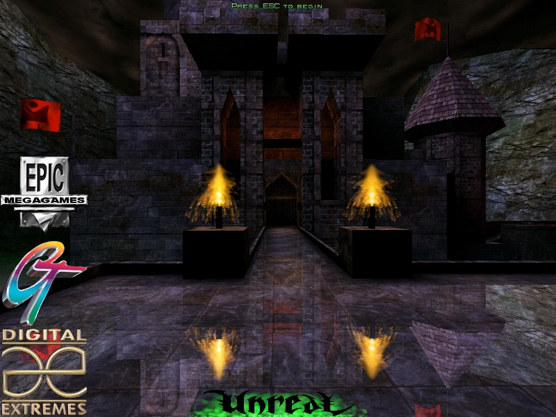
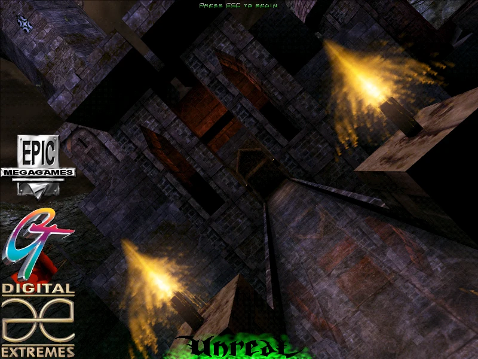
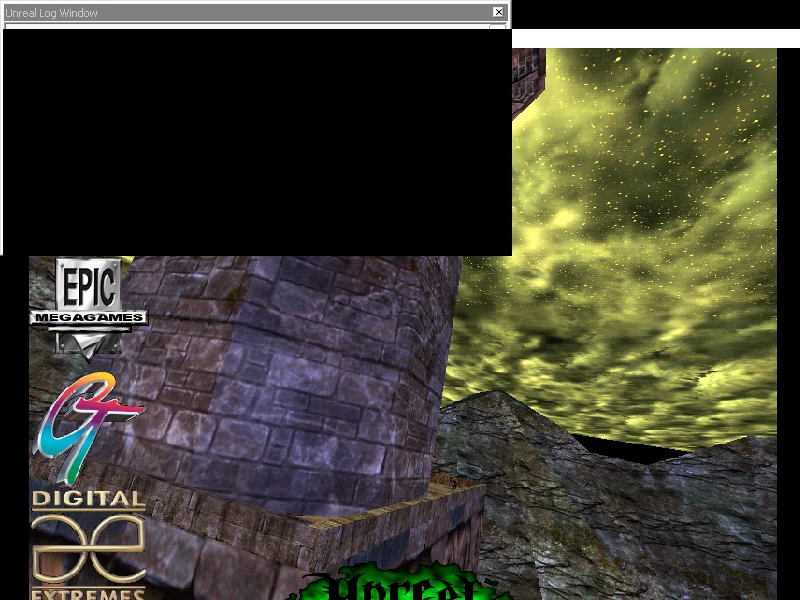
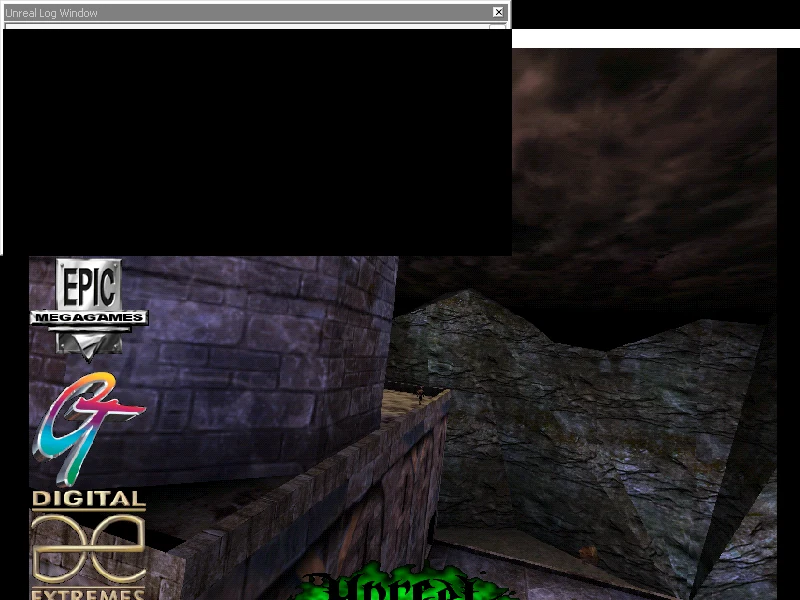
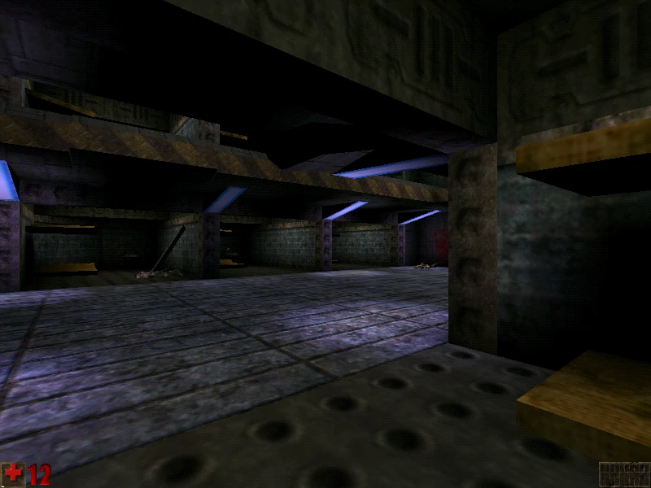
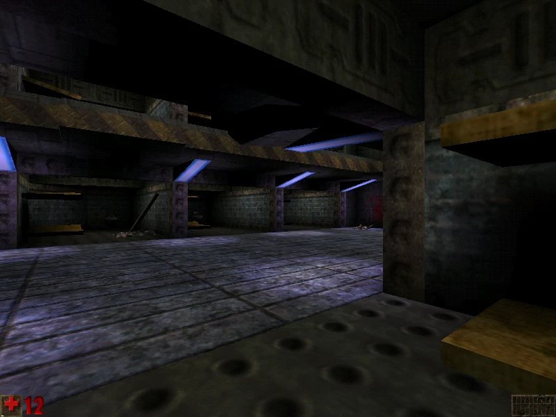
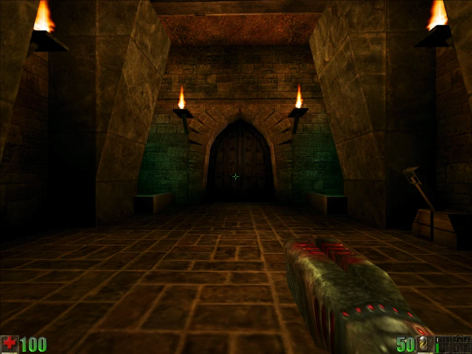
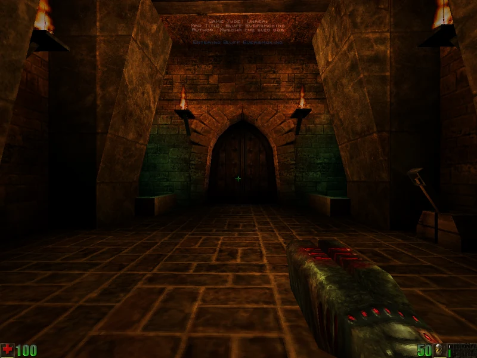
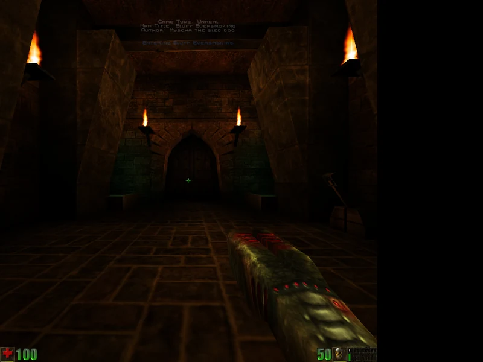

# Unreal (1998 — Win32 Glide 2.x)

| Field | Value |
| :--- | :--- |
| **Category** | Commercial Game |
| **Year** | 1998 |
| **Platform(s)** | `Win32 / Wine (glide2x.dll)` |
| **Glide API & Version** | Glide 2.x (`2.56` on Voodoo2 / `2.48` on Voodoo Graphics SST-1) |
| **Recommended Card Profile** | `Voodoo2` (default, dual-TMU `800×600`) · `VoodooGraphics` (`2.48`, single-TMU `640×480`) |
| **Verified Backends** | Vulkan · OpenGL ES (WGL) · Software (AVX2 / AVX-512 / Scalar) |
| **Preset File(s)** | [`glide-ng.ini`](./glide-ng.ini) (Voodoo2) · [`glide-ng.hq.ini`](./glide-ng.hq.ini) (4× MSAA + Linear) · [`glide-ng.voodoo1.ini`](./glide-ng.voodoo1.ini) (Voodoo1 SST-1) · [`glide-ng.software.ini`](./glide-ng.software.ini) (CPU Software) |
| **Status** | Verified |

---

## Overview

Epic MegaGames and Digital Extremes' landmark 1998 first-person shooter *Unreal* runs on **Unreal Engine 1**, which was originally architected around **3dfx Glide 2.x** (`GlideDrv.dll` → `glide2x.dll`). Features including detail textures, multi-pass modulated dynamic lightmaps (`RGB565` / `ARGB1555` / `P_8`), volumetric atmospheric fog, planar shiny marble reflections, procedural `Fire.dll` fractal water and cloud surfaces, colored dual-torch lighting, and additive coronas all look crispest and most faithful through `GlideDrv.GlideRenderDevice`.

Technically, `GlideDrv.dll` provides one of the best real-world **streaming texture upload** stress tests in the catalog across two areas uncovered and resolved inside `glide-ng`:

1. **Tightly-packed standalone `grTexDownloadMipMapLevelPartial` lightmaps:** Unreal Engine 1 streams non-power-of-two-height dynamic lightmaps and animated procedural cloud/water textures directly into TMU linear RAM via `grTexDownloadMipMapLevelPartial(tmu, addr, thisLod, largeLod, aspect, fmt, mask, data, 0, actualRows - 1)` **without** issuing a prior `grTexDownloadMipMap()` call, packing the very next texture immediately at `addr + align8(w × actualRows × bpp)`. `glide-ng`'s `TextureManager::DownloadMipMapPartial()` now auto-allocates unallocated partial targets, dynamically widens mip chains if additional LODs stream in, and tracks the compact written byte footprint so adjacent tightly packed lightmaps never falsely evict one another.
2. **Win32 Vulkan texture staging ring capacity:** During initial level load and the `Unreal.unr` castle flyby, `GlideDrv.dll` rotates several megabytes of textures per second through the active frame slot. Expanding the 32-bit Vulkan persistent texture staging slot from `4 MB` (`8 MB` total) to **`16 MB` (`32 MB` total)** cuts mid-frame staging flushes by **~98%** (`391` warnings across `376` frames → `8` startup-only frames, **`0` warnings** during steady-state gameplay).

---

## Editions, Patches & Executables

| Executable / Renderer | Graphics API | Works with `glide-ng`? | Technical Notes |
| :--- | :--- | :---: | :--- |
| **`Unreal.exe` (v226f Final) + `GlideDrv.dll`** | **Glide 2.x (`glide2x.dll`)** | **Yes (Recommended)** | Official Epic Games *Unreal Patch 226 Final*. Eliminates the retail startup log window, updates `GlideDrv.dll` stability, adds native `D3DDrv.dll` / `OpenGlDrv.dll` drivers, and renders crisp `800×600` (`Voodoo2`) and `640×480` (`Voodoo1`) planar mirrors, flickering torch flames, detail textures, and dynamic lightmaps across all three `glide-ng` backends. |
| **`Unreal.exe` (Retail v200, May 1998) + `GlideDrv.dll`** | Glide 2.x (`glide2x.dll`) | Yes (Alternate) | Unpatched retail CD installation. Loads and renders identically through `glide2x.dll` once `CdPath=..\` is configured; slightly older `GlideDrv.dll` spawns a separate `Unreal Log Window` briefly on headless X11 stacks without a window manager. |
| **OldUnreal `v227i` community patch** *(optional)* | Glide 2.x / OpenGL / D3D9 / XOpenGL | Optional | Maintained fan patch providing modern audio (`ALAudio`/`FMod`), raw-input scaling, and high-res modern renderers. Classic `GlideDrv.dll` remains available inside `227i` if retro 3dfx testing is preferred. |
| **`SoftDrv.SoftwareRenderDevice` (`SoftDrv.dll`)** | CPU Software (16-bit) | No (No 3dfx) | Epic's built-in software rasterizer. Works reliably as a reference, but exhibits pixelated point-sampled textures, coarser specular shading, and flat muted dynamic flame glows without bilinear filtering or `4× MSAA`. |
| **`D3DDrv.D3DRenderDevice` (`D3DDrv.dll`)** | Direct3D 6/7 | No (No 3dfx) | Official v226f Direct3D driver (runs via Wine `wined3d`). Renders **with darker shadow crush** and clips the right viewport strip (`800 px` drawable inside a `1024×768` fullscreen container leaving a `224 px` black bar) under Wine. |
| **`OpenGLDrv.OpenGLRenderDevice` (`OpenGlDrv.dll`)** | OpenGL 1.x | No (Crashes on Mesa) | Epic's stock 1999 experimental OpenGL driver hard-crashes during startup inside `appSprintf` when logging modern `glGetString(GL_EXTENSIONS)` strings (even under `MESA_EXTENSION_MAX_YEAR=1999`). |

> **Note: Verdict**
> **`GlideDrv.GlideRenderDevice` via `glide-ng` (`glide2x.dll`) is the clear visual and stability winner over all three stock v226f renderers**, with **`glide-ng.hq.ini` (`4× MSAA` + `linear`)** delivering the crispest anti-aliased castle edges, smooth detail grain, unclipped `800×600` framing, and full mirrored surface reflections.

---

## Launch Commands (Win32 / Wine)

Copy `glide2x.dll` from `glide-ng`'s Win32 build into the game's **`System/`** directory (next to `Unreal.exe`). Edit **`System/Unreal.ini`** to disable the CD check (after copying all CD assets to disk) and select `GlideDrv.GlideRenderDevice`:

```ini
[FirstRun]
FirstRun=226

[Engine.Engine]
CdPath=..\
GameRenderDevice=GlideDrv.GlideRenderDevice
RenderDevice=GlideDrv.GlideRenderDevice

[Core.System]
CdPath=..\

[WinDrv.WindowsClient]
FullscreenViewportX=800
FullscreenViewportY=600
StartupFullscreen=True
Brightness=0.500000

[GlideDrv.GlideRenderDevice]
Translucency=True
VolumetricLighting=True
ShinySurfaces=True
Coronas=True
HighDetailActors=True
DetailBias=-1.500000
RefreshRate=60Hz
DetailTextures=True
FastUglyRefresh=False
ScreenSmoothing=True
Resolution=Default
```

*(For unpatched retail **`v200`**, set `FirstRun=False` instead of `FirstRun=226`. For the **`Voodoo1` single-TMU preset**, set `FullscreenViewportX=640` and `FullscreenViewportY=480` since authentic SST-1 caps out at `640×480`.)*

### Standard Launch (`glide-ng.ini` — Vulkan `1×`, `nearest` Scaling)

```bash
cd /path/to/unreal/System
WINEDLLOVERRIDES="glide2x=n" \
GLIDE_NG_CONFIG=/path/to/docs/catalog/games/unreal/glide-ng.ini \
  wine ./Unreal.exe
```

### Best Visuals (`glide-ng.hq.ini` — Vulkan `4× MSAA` + Linear Upscale)

```bash
cd /path/to/unreal/System
WINEDLLOVERRIDES="glide2x=n" \
GLIDE_NG_CONFIG=/path/to/docs/catalog/games/unreal/glide-ng.hq.ini \
  wine ./Unreal.exe
```

### Authentic Voodoo Graphics (`glide-ng.voodoo1.ini` — Single-TMU, `640×480`)

```bash
cd /path/to/unreal/System
WINEDLLOVERRIDES="glide2x=n" \
GLIDE_NG_CONFIG=/path/to/docs/catalog/games/unreal/glide-ng.voodoo1.ini \
  wine ./Unreal.exe
```

### CPU Software Backend (`glide-ng.software.ini` — AVX2 / AVX-512)

```bash
cd /path/to/unreal/System
WINEDLLOVERRIDES="glide2x=n" \
GLIDE_NG_CONFIG=/path/to/docs/catalog/games/unreal/glide-ng.software.ini \
  wine ./Unreal.exe
```

To jump straight into a specific map without traversing the menu (useful for benchmarking or regression verification), append the map filename as a positional argument: `wine ./Unreal.exe Bluff.unr` or `wine ./Unreal.exe DmDeck16.unr`.

---

## Visual Progression Gallery

### 1. Title Flyby (`Unreal.unr`), Menu & `DownloadMipMapPartial` Fix (`800×600` / `640×480`)

| Nali Castle Courtyard — OpenGL ES / WGL (`800×600`) | Nali Castle Twin Torches — Vulkan `4× MSAA` HQ (`800×600`) |
| :---: | :---: |
|  |  |
| Planar mirror marble floor reflecting flickering braziers, arch portcullis, and turret banners (`WARN=0`). | Crisp `4× MSAA` stone battlements, glowing additive flame sparks, and bridge reflections. |

| Nali Castle Keep — Vulkan `1×` (`Voodoo2 2.56`) | Nali Castle — Voodoo Graphics SST-1 (`640×480`, `2.48`) |
| :---: | :---: |
|  |  |
| Climbing stone parapet framed against dark rolling storm clouds (`16 MB` Vulkan staging slot). | Authentic single-TMU multipass rendering (`1×2 MB TMU`, `640×480`) matches dual-TMU output. |

| Main Menu Overlay — Software AVX2 (`v226f`) | Retail May 1998 `v200` — Vulkan `1×` (`800×600`) |
| :---: | :---: |
|  |  |
| Embossed stone menu bar (`Esc`), translucent `VERSION 226` tag, and starlit skybox (`WARN=0`). | Unpatched retail `v200` CD release verified over the same `glide2x.dll` drop-in. |

| Before Fix — Discarded `DownloadMipMapPartial` (`v200`) | After Fix — Auto-Allocated Partial Lightmaps (`v200`) |
| :---: | :---: |
|  |  |
| Dropped streaming lightmaps left neon yellow-green unlit sky clouds (`25,000+` warnings, `2.1 MB` log). *(The top-left rectangle is retail `v200`'s startup log window.)* | Exact same frame with the fix: brooding violet-brown clouds, stars, torchlit walls, and **`0` warnings** (`245 B` log). |

### 2. Campaign & Deathmatch Maps (`v226f`)

| *NyLeve's Falls* — Valley Panorama (`Vulkan 4× MSAA`) | *NyLeve's Falls* — Cliff & Waterfall (`Vulkan 4× MSAA`) |
| :---: | :---: |
|  |  |
| Na Pali valley skybox, distant mountain peaks, Nali hut, and grass detail textures on `NyLeve.unr`. | Glowing turquoise waterfall, stone trench ridges, and dramatic storm clouds. |

| *Vortex Rikers* (`Vortex2.unr`) — Vulkan `1×` | *Vortex Rikers* (`Vortex2.unr`) — OpenGL ES / WGL |
| :---: | :---: |
|  |  |
| Crashed prison ship deck with blue fluorescent reflections and red health HUD (`WARN=0`). | Identical cross-backend lighting, metallic floor reflections, and crisp sprites (`WARN=0`). |

| *Vortex Rikers* (`Vortex2.unr`) — Software AVX2 | *DM-Tundra* (`DmTundra.unr`) — Vulkan `1×` |
| :---: | :---: |
|  |  |
| Exact parity on the AVX2/AVX-512 CPU rasterizer with `no_dither_sub = true` (`WARN=0`). | Cool violet mountain lightmaps and twilight starry skybox inside `DmTundra.unr`. |

| *DM-Deck16* (`DmDeck16.unr`) — Vulkan `4× MSAA` (`800×600`) | *DM-Deck16* — Voodoo1 Single-TMU (`640×480`) |
| :---: | :---: |
|  |  |
| Iconic industrial ramps, anti-aliased edges, crate lighting, and subtle green sludge bounce glow. | Single-TMU `VoodooGraphics` (`2.48`) parity right at the original 1996 card resolution ceiling. |

### 3. Renderer & Flavour Comparison — *Bluff Eversmoking* (`Bluff.unr`)

| `GlideDrv` — Vulkan `1×` (`glide-ng.ini`) | `GlideDrv` — Vulkan `4× MSAA` HQ (`glide-ng.hq.ini`) |
| :---: | :---: |
|  |  |
| Warm torchlit stone arches, emerald lower-wall ambient light, and sharp Dispersion Pistol. | Smoothed arch and doorway edges with `4× MSAA` offscreen resolve and linear scaling. |

| `GlideDrv` — OpenGL ES / WGL (`1×`) | `GlideDrv` — Software AVX2 (`glide-ng.software.ini`) |
| :---: | :---: |
|  |  |
| Vivid additive map intro text overlay (captured before fade-out completes) with full color parity. | CPU rasterizer matches GPU lightmap falloff, torch flame blending, and stone detail seamlessly. |

| Epic Stock `SoftDrv.dll` (16-bit CPU Reference) | Epic Stock `D3DDrv.dll` (Wine `wined3d` Reference) |
| :---: | :---: |
|  |  |
| Unfiltered nearest-neighbor sampling with noticeably duller, clipped orange torch flames. | Darker contrast crush plus right-side `224 px` black clip bar inside the `1024×768` window under Wine. |

---

## Tuning & Known Quirks

- **Do NOT enable `[display] fullscreen = true` (`GLIDE_NG_FULLSCREEN=1`):** *Unreal*'s `WinDrv.WindowsClient` owns its own fullscreen/window bounds lifecycle. Injecting an extra `SetWindowPos()` resize during `grSstWinOpen` triggers a re-entrant `WM_SIZE` → `UWindowsViewport::Repaint` → `UGlideRenderDevice::DrawComplexSurface` call *before* Unreal's `FMemCache` finishes initializing, causing an assertion failure (`Assertion failed: Initialized [UnCache.cpp]`). Leave `[display] fullscreen = false` (default) and let `Unreal.ini`'s `StartupFullscreen=True` size the viewport.
- **Avoid Wine virtual desktops narrower than the viewport height:** When running `800×600` inside `wine explorer /desktop=Unreal,800x600`, window borders/title bars shave `~22 px` vertically (`800×578`), clipping the lower rim of the bottom green **`Unreal`** logo. Use `1024×768` (or direct `wine ./Unreal.exe` on a normal desktop) for an exact `800×600` drawable.
- **No-CD asset check (`CdPath=..\`):** Both retail `v200` and patched `v226f` probe `Palettes.utx` beneath `CdPath`. Adding `CdPath=..\` under both `[Engine.Engine]` and `[Core.System]` lets a full disk install boot cleanly without keeping the CD-ROM image mounted.
- **`v226f` `OpenGlDrv.dll` startup crash:** Modern OpenGL drivers expose extension strings far exceeding the fixed buffer inside stock 1999 `OpenGlDrv.dll` (`appSprintf` truncation/crash while writing `Unreal.log`). Use `GlideDrv.GlideRenderDevice` via `glide-ng` instead (or OldUnreal `227i` for modern OpenGL).
- **Brightness & gamma:** Leave `[glide] gamma` unset in `glide-ng.ini` so *Unreal*'s in-game `Options → Video → Brightness` slider (`F11` shortcut, `grGammaCorrectionValue`, default `0.5` → `1.25`) drives the RAMDAC LUT smoothly without double-brightening dark interiors.
- **Dynamic cache sizing (`CacheSizeMegs`):** Bumping `[Engine.GameEngine] CacheSizeMegs=4` to **`16`** reduces surface cache thrashing in sprawling outdoor levels like *NyLeve's Falls* and *Bluff Eversmoking*.
- **`GlideDrv.dll` startup resolution:** Keep `[GlideDrv.GlideRenderDevice] Resolution=Default` so *Unreal* respects `FullscreenViewportX` / `FullscreenViewportY` cleanly (`800×600` on `Voodoo2`, `640×480` on `VoodooGraphics`).

---

## Quick Controls

| Key | Action |
| :--- | :--- |
| **`Esc`** | Open / close the main menu (`GAME / MULTIPLAYER / OPTIONS / AUDIO/VIDEO / QUIT`) |
| **`W` / `A` / `S` / `D`** or **Arrow keys** | Move / turn *(configure modern mouse-look in `Options → Customize Controls`)* |
| **`Space`** / **`C`** | Jump / Crouch (ascend during `fly` / `ghost`) |
| **`Left Click` / `Ctrl`** | Primary fire |
| **`Right Click` / `Alt`** | Alternate fire |
| **`Tab`** / **`~`** | Open quick command line / full Unreal console (e.g. `timedemo 1`, `fov 90`) |
| **`F11`** | Adjust brightness / gamma (`grGammaCorrectionValue`) |
| **`Alt+Enter`** | Toggle fullscreen / windowed viewport |

---

## See Also

- [Compatibility Catalog Index](../../README.md)
- [Hardware Profiles & Glide Versions](../../../user-guide/hardware-and-versions.md)
- [Configuration & Environment Variables](../../../user-guide/configuration.md)
- [Troubleshooting Guide](../../../user-guide/troubleshooting.md)
