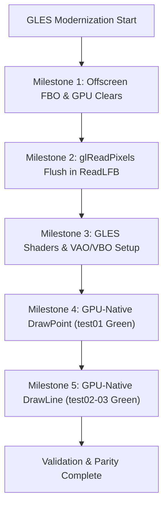

# OpenGL ES Backend Modernization Plan (Phase 2)

This document outlines the architectural plan to upgrade our **OpenGL ES staging backend** (`OpenGLESBackend`) from a pure software-rasterizer presentation blitter to a **true GPU-native, hardware-accelerated rendering pipeline**. This will give us **three fully independent rendering pipelines** (Software CPU, Vulkan GPU, and OpenGL ES GPU) for visual regression testing and cross-platform portability.

---

## 1. Architectural Motivation & Benefits

1. **API Parity & Verification**: Having two independent GPU pipelines (Vulkan & OpenGL ES) running side-by-side allows us to easily isolate driver-specific compiler issues, rasterization edge-cases, and subpixel rounding variances.
2. **Enhanced Portability**: OpenGL ES 3.0/3.2 is the industry standard for mobile (Android/iOS), embedded devices, and web platforms (WebGL). A true GLES hardware pipeline makes the Glide wrapper instantly portable to environments where Vulkan is unavailable.
3. **Progressive Migration Success**: We will utilize the exact same **Progressive Hybrid Architecture** that brought Vulkan to 100% success—inheriting from `SoftwareBackendBase` to fall back to CPU rasterization for unimplemented primitives, allowing us to keep all tests green at every milestone.

---

## 2. High-Level Comparison: Vulkan vs. OpenGL ES Modernization

Modernizing OpenGL ES is significantly simpler than Vulkan because GLES handles memory management, image layout transitions, and pipeline barriers automatically under the hood:

| Architectural Component | Vulkan Backend (`VulkanBackend`) | OpenGL ES Backend (`OpenGLESBackend`) |
| :--- | :--- | :--- |
| **Offscreen Target** | Headless `vk::Image` + `vk::Framebuffer` | Framebuffer Object (FBO) + `glBindFramebuffer` |
| **Synchronization** | Explicit layout transitions & pipeline barriers | Automatic driver-managed synchronization |
| **GPU Readback** | Queue submission, `waitIdle()`, cache invalidation | Synchronous, immediate `glReadPixels(...)` |
| **State Pipeline** | `vk::Pipeline` (Pre-compiled fixed states) | Direct State API (`glDepthFunc`, `glBlendFunc`, etc.) |
| **Shaders** | SPIR-V binaries compiled via CMake | GLSL ES text compiled dynamically at runtime |
| **Vertex Attributes** | Dynamic ring vertex buffer + Host Memory Map | Dynamic VBO (`glBufferSubData`) + VAO |

---

## 3. Step-by-Step Implementation Roadmap

### Milestone 1: Offscreen FBO & GPU Clears (Headless Compatibility)
Currently, OpenGL ES renders to the default window surface. To support robust headless CI execution and clean readbacks:
1. **Create Offscreen FBO**: Generate an offscreen framebuffer object (`m_headlessFBO`) and a color texture attachment during `AttachWindow`.
2. **GPU-Native Clear**: Override `ClearBuffer` to bind the FBO, convert the 32-bit Glide clear color to float RGBA, and call `glClearColor(...)` followed by `glClear(GL_COLOR_BUFFER_BIT)`.
3. **Staging Blit**: In `SwapBuffers`, if a window is attached, blit the FBO texture to the default window framebuffer and call `SDL_GL_SwapWindow`.

### Milestone 2: GPU Readback Flush (`ReadLFB`)
To resolve the visual regression capture synchronization (the race condition that caused black frames on Vulkan):
1. Declare and override `ReadLFB` in `OpenGLESBackend`.
2. **Cache CPU Text**: Prior to the GPU copy, cache any CPU-rasterized console text drawn into `m_headlessPixelMap`.
3. **Pipeline Flush & Readback**: Call `glReadPixels(0, 0, width, height, GL_RGBA, GL_UNSIGNED_BYTE, m_headlessPixelMap)`. GLES automatically blocks the CPU thread until all pending draw calls are rasterized and copied back.
4. **Restore CPU Text**: Merge the cached text pixels back on top of the staging buffer.
5. **Base-Class Delegate**: Call `SoftwareBackendBase::ReadLFB(...)` to convert pixels to the RGB565 format expected by the test runner.

### Milestone 3: GLSL ES Shaders & VAO/VBO Setup
1. **Author Shaders**: Embed GLSL ES 300 shaders in `OpenGLESBackend.cpp`:
   - **Vertex Shader**: Converts window-space vertex coordinates to GLES NDC using a uniform viewport size:
     `ndcX = (inPos.x / (uViewportSize.x / 2.0)) - 1.0;`
   - **Fragment Shader**: Selects between vertex color and constant color uniforms based on the register combiner state.
2. **Compile at Runtime**: Compile and link shaders during initialization, logging any compiler errors to `GLIDE_LOG`.
3. **Dynamic VBO**: Create a dynamic Vertex Buffer Object:
   - `glGenBuffers(1, &m_vbo);`
   - `glBindBuffer(GL_ARRAY_BUFFER, m_vbo);`
   - `glBufferData(GL_ARRAY_BUFFER, 1024 * 1024, nullptr, GL_DYNAMIC_DRAW);` (1MB ring buffer)
4. **VAO Binding**: Configure a Vertex Array Object (VAO) to map `ModernVertex` attributes (pos, color, tex) to shader layout locations.

### Milestone 4: GPU-Native Point Drawing (`DrawPoint`)
1. Declare and override `DrawPoint(const ModernVertex& pt)` in `OpenGLESBackend`.
2. **Upload Vertex**: Upload the vertex data to the dynamic VBO using `glBufferSubData`.
3. **Bind Shader & Uniforms**: Bind the shader program, upload the viewport size and color combiner uniforms.
4. **Draw Call**: Bind the FBO, bind the VAO, and issue the native draw call:
   - `glDrawArrays(GL_POINTS, firstVertex, 1);`
5. Bypasses the CPU software rasterizer, bringing `test01` to 100% GPU-native execution.

### Milestone 5: GPU-Native Line Drawing (`DrawLine`)
1. Declare and override `DrawLine(const ModernVertex& v1, const ModernVertex& v2)` in `OpenGLESBackend`.
2. **Upload Vertices**: Upload the two vertices to the VBO ring buffer.
3. **Draw Call**: Issue the native line draw call:
   - `glDrawArrays(GL_LINES, firstVertex, 2);`
4. GLES automatically interpolates color attributes along the line, bringing both flat lines (`test02`) and Gouraud shaded lines (`test03`) to 100% GPU-native execution!

---

## 4. Resource Cleanup and Safety
To prevent resource leaks and ordering crashes (like the one we solved on Vulkan):
* We will cleanly release all GLES resources (`m_headlessFBO`, VBO, VAO, shader program, and textures) inside `OpenGLESBackend::DetachWindow()` prior to releasing the main EGL/GL context in `Shutdown()`.
