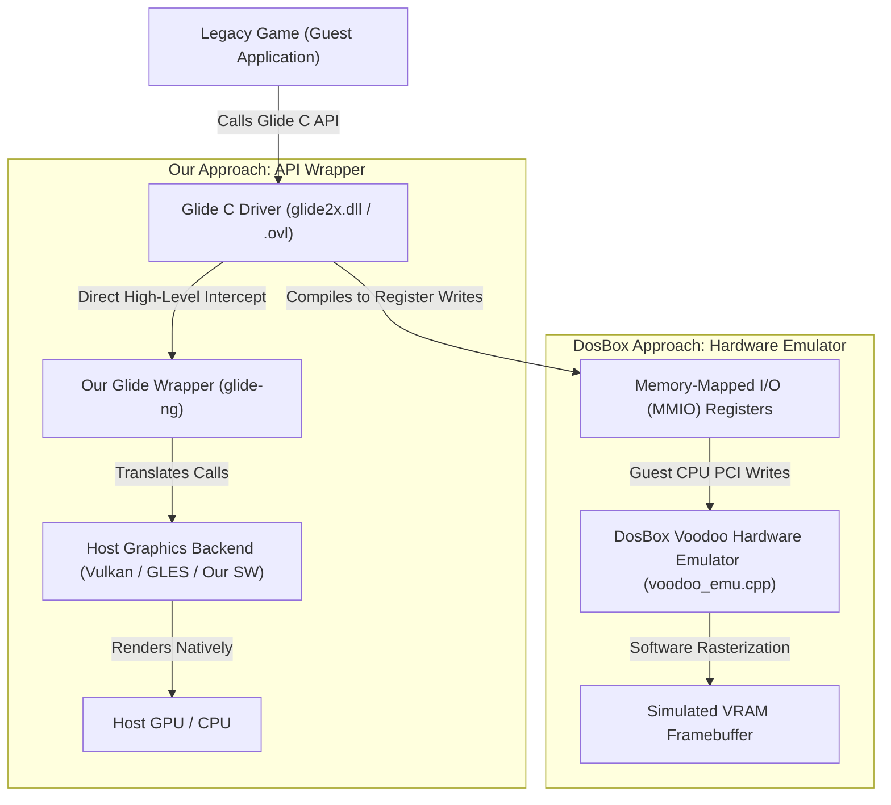

# Glide API Translation vs. Register-Level Emulation

This document explains the architectural difference between our **Glide2 API-level wrapper** (documented in [docs/glide2_api_checklist.md](file:///usr/local/google/home/eianiuk/gemini/3dfx/docs/glide2_api_checklist.md)) and the **DosBox Hardware Emulator** ([ext_tests/dosbox-0/src/hardware/voodoo_emu.cpp](file:///usr/local/google/home/eianiuk/gemini/3dfx/ext_tests/dosbox-0/src/hardware/voodoo_emu.cpp)), detailing how they interface and how high-level Glide C functions map to low-level physical registers.

---

## 1. The Core Architectural Divide

The two codebases operate at entirely different layers of the graphics stack:

### A. Our Glide Wrapper (`glide-ng`)
*   **Abstraction Level**: **High-Level API Translation**.
*   **How it works**: When the game calls a Glide function like `grDrawTriangle()` or `grAlphaBlendFunction()`, our wrapper intercepts the call directly at the C linkage level. We map this high-level drawing state directly to modern host graphics APIs (Vulkan, OpenGL ES) or our high-level CPU Software rasterizer.
*   **Hardware Knowledge**: Our wrapper has **no concept of Voodoo physical registers, PCI FIFOs, or VRAM memory layouts**. We bypass the hardware register layer entirely!
*   **Performance**: Extremely fast (near-native speed) because we leverage the host's physical GPU to draw the geometry.

### B. The DosBox Hardware Emulator (`voodoo_emu.cpp`)
*   **Abstraction Level**: **Low-Level Register Emulation (ASIC Simulation)**.
*   **How it works**: The game runs inside the DOS emulator and talks to a guest Glide driver. That driver compiles the Glide calls into **raw writes to physical memory addresses** representing the Voodoo card's PCI registers (like writing vertex coordinates to register `0x0` or texture modes to register `0x120`). `voodoo_emu.cpp` intercepts these memory-mapped I/O (MMIO) writes, extracts parameters from the registers, and runs Aaron Giles' software pipeline to draw pixels into a simulated VRAM buffer.
*   **Performance**: Extremely slow on CPU because every single triangle draw involves dozens of guest CPU register writes and memory reads, which must be emulated in software.

---

## 2. The Bridge: Glide Pass-Through

Wait! Does a game running inside DosBox have to run through slow register-level emulation? 

No! This is where **Glide Pass-Through** (implemented in DosBox's [glide.cpp](file:///usr/local/google/home/eianiuk/gemini/3dfx/ext_tests/dosbox-0/src/hardware/glide.cpp)) comes in:

1.  Instead of using a standard guest Glide driver that writes to Voodoo registers, the user installs a special **Pass-Through Guest Glide Driver**.
2.  When the game calls a Glide API function in the guest, this special driver writes the function arguments to a custom **virtual I/O port (a backdoor)**.
3.  DosBox's `glide.cpp` intercepts this backdoor write, reads the parameters directly from guest memory, and **forwards the call to the host system's Glide library (which is our library!)**.
4.  Our wrapper then renders the frame at lightning speed using Vulkan/GL on the host GPU, bypassing `voodoo_emu.cpp` entirely!

---

## 3. How Glide API Concepts Map to Voodoo Registers

To understand what happens under the hood when our high-level Glide functions are translated to low-level hardware, here is a mapping of key Glide API functions to their corresponding register-level operations in `voodoo_emu.cpp`:

### A. State Configuration
| Glide API Function (Our Wrapper) | Voodoo Hardware Register (`voodoo_emu.cpp`) | Description |
| :--- | :--- | :--- |
| `grAlphaBlendFunction(...)` | `fbzMode` (alpha blend fields) | Sets source/destination blend factors. |
| `grDepthBufferMode(...)` | `fbzMode` (depth enable & depth write fields) | Enables/disables Z-buffering or W-buffering. |
| `grChromakeyMode(...)` | `chromaKey` / `fbzMode` | Enables chroma keying and sets the transparency color match value. |
| `grClipWindow(...)` | `clipLeftRight` / `clipBottomTop` | Configures the hardware clipping boundaries. |
| `grConstantColorValue(...)` | `color0` / `color1` | Sets constant colors used by the register combiners. |

### B. Texture Mapping & Bindings
| Glide API Function (Our Wrapper) | Voodoo Hardware Register (`voodoo_emu.cpp`) | Description |
| :--- | :--- | :--- |
| `grTexSource(...)` | `texBaseAddr` / `texBaseAddr_1` | Binds a texture by setting the starting physical VRAM address for TMU0/TMU1. |
| `grTexCombine(...)` | `textureMode` | Configures the texture blending/combining factors (e.g. blend, decal, modulate). |
| `grTexFilterMode(...)` | `textureMode` (min/mag filter fields) | Toggles between Point Sampling and Bilinear Filtering. |

### C. Drawing Primitives
| Glide API Function (Our Wrapper) | Voodoo Hardware Register (`voodoo_emu.cpp`) | Description |
| :--- | :--- | :--- |
| `grDrawTriangle(...)` | `triangle` (Command trigger) | The guest driver writes vertex data to registers (`ax`, `ay`, `startr`, etc.) and then writes to the `triangle` command register, which triggers `setup_and_draw_triangle()` in `voodoo_emu.cpp`. |
| `grLfbWriteRegion(...)` | LFB Memory Range (`0x00000000` in VRAM) | Guest CPU copies pixels directly to the framebuffer aperture. `voodoo.cpp` intercepts the write and writes directly to the simulated VRAM. |
| `grSstIdle(...)` | `sstStatus` | Blocks until the command FIFO is empty and the rasterizer status flags report idle. |
