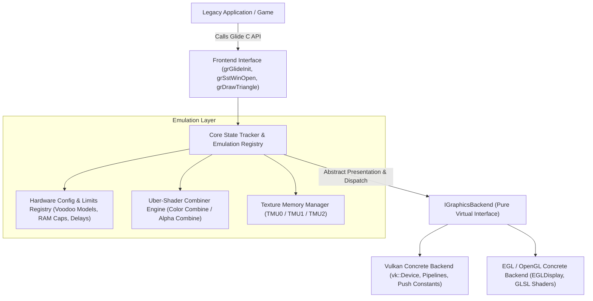

# 3dfx Glide Modernization Wrapper Project Plan

This document outlines the end-to-end implementation and architectural plan for building a highly modular, drop-in replacement wrapper for the legacy **3dfx Glide graphics API** (Glide 2.x and Glide 3.x). Under the hood, this wrapper translates low-level Voodoo hardware calls into modern high-performance graphics APIs (**Vulkan**, **OpenGL**, and **EGL**), enabling classic speed-sensitive applications and games to execute seamlessly on modern operating systems without original 3dfx hardware.

---

## 1. Executive Summary & Core Objectives

1. **Exact ABI/API Compatibility**: Export native C-compatible dynamic libraries (`glide2x.dll`/`libglide2x.so` and `glide3x.dll`/`libglide3x.so`) matching the official 3dfx SDK specifications exactly.
2. **Modular Multi-Backend Architecture**: Decouple the frontend Glide state machine from the rendering backend, allowing effortless switching and future expansion (starting with **Vulkan** for maximum performance and explicit synchronization, followed by **EGL/OpenGL ES** for wide compatibility).
3. **Faithful Hardware Emulation**: Respect Voodoo family variations (Voodoo Graphics SST-1, Voodoo2 CVG, Voodoo3 H3, Voodoo4/5 H5) by exposing configurable memory caps, active chip limits, and artificial bus/draw delays to preserve classic gameplay synchronization.
4. **Iterative Chunks & Test-Driven Milestones**: Break the extensive Glide API surface into small, verifiable subsets ("chunks"). Each implementation chunk is validated directly against the original 3dfx SDK diagnostic test suites located in `./3dfx-Glide-API` and `./glide`.

---

## 2. Language Selection & Toolchain

### Recommended Implementation Language: **C++20**

**Rationale and Advantages:**
* **ABI Drop-in Compatibility**: C++ easily exports un-mangled C symbols via `extern "C"`, required for building transparent replacement DLLs and Shared Objects.
* **Modern Graphics Ecosystem**: Native, high-performance bindings exist for all target backends, including `Vulkan-Hpp` / `volk` for Vulkan and `GLAD` / `GLEW` for EGL/OpenGL.
* **Zero-Cost Abstractions**: Enables elegant vector/matrix math utilities, tight memory alignment controls, and strongly typed enum bitmasks without runtime penalty.
* **Polymorphism & State Management**: Virtual interfaces (`IGraphicsBackend`) and compile-time variants (`std::variant`) provide an elegant pattern for hot-swappable backends and clean separation of complex Glide state combinations (e.g., Pimpl idiom).
* **Build System**: **CMake** will be used across the entire toolchain to guarantee seamless multi-platform compilation (Windows Mingw-w64 / MSVC and Linux GCC/Clang).

---

## 3. Modular System Architecture

The wrapper architecture is separated into three highly distinct layers: the **Frontend Glide API layer**, the **Core State Tracker & Emulation Registry**, and the **Polymorphic Rendering Backend Layer**.



### Core Architecture Components

1. **Frontend Interface**: Exposes the standard `FX_ENTRY` C functions. Captures client invocations, updates active `GrContext` references, and delegates drawing tasks.
2. **Emulation & Hardware Registry**: 
   * Tracks simulated hardware profiles (`GrHwConfiguration`).
   * Manages Virtual Texture Memory and enforces per-TMU byte usage.
   * Computes Glide texture swizzles, MIP-map offsets, and memory alignment constraints.
3. **Uber-Shader Engine**: 
   * Old Glide relies on highly flexible fixed-function register combiners (`grColorCombine`, `grAlphaCombine`).
   * The wrapper will generate highly optimized **GLSL / SPIR-V uber-shaders** that map active Glide combine configurations (e.g., `GR_COMBINE_FUNCTION_SCALE_OTHER_MINUS_LOCAL`, `GR_ALPHASOURCE_TEXTURE_ALPHA`) directly to push constants or dynamic uniform buffers.
4. **Abstract Backend (`IGraphicsBackend`)**: Defines the unified rendering interface:
   ```cpp
   class IGraphicsBackend {
   public:
       virtual ~IGraphicsBackend() = default;
       virtual bool InitializeDevice(const HardwareConfig& config) = 0;
       virtual bool CreateWindowSurface(void* nativeWindowHandle, const GlideResolution& res) = 0;
       virtual void SetRenderState(const GlideRenderState& state) = 0;
       virtual bool AllocateTexture(uint32_t tmuId, const TextureData& tex) = 0;
       virtual void DrawTriangles(const Vertex* vertices, size_t count) = 0;
       virtual void ClearBuffer(GrColor_t color, GrAlpha_t alpha, uint32_t depth) = 0;
       virtual void SwapBuffers(uint32_t swapInterval) = 0;
       virtual bool LockLfb(GrBuffer_t buffer, void** outData, uint32_t* outStride) = 0;
       virtual void UnlockLfb(GrBuffer_t buffer) = 0;
   };
   ```

---

## 4. Hardware Emulation & Configurable Specifications

Legacy 3dfx games often execute hardware queries (`grSstQueryHardware`, `grSstQueryBoards`) to self-tune game resolutions, texture levels, and engine tick rates. Furthermore, running 1990s CPU-dependent rendering loops on modern GHz CPUs can cause severe speedups or physics glitches. 

To solve this, the wrapper loads a configurable profile or parses active environment variables.

### Pluggable Configuration Loader Architecture
During `grGlideInit`, the wrapper automatically checks the current working directory for a configuration file. To keep the format fully future-proof and customizable, configuration parsing is decoupled behind an abstract interface:
```cpp
class IConfigLoader {
public:
    virtual ~IConfigLoader() = default;
    virtual bool Load(const std::string& configFilePath, WrapperConfig& outConfig) = 0;
};
```
* **Default File Name & Format**: `glide_config.json`. We choose **JSON** (`JsonConfigLoader`) for its hierarchical structure, making it ideal for defining per-TMU parameters and complex swizzles.
* **Extensibility**: If modders prefer **INI** (`glide_wrapper.ini`) or **YAML** in the future, simply implement `IniConfigLoader` and swap the provider in the core registry.
* **Resolution Priority**: (1) Application Direct API Arguments -> (2) Environment Variables (`GLIDE_WRAPPER_*`) -> (3) Local `glide_config.json` -> (4) Base Fallback Defaults.

| Parameter | Options / Description | Example Impact |
| :--- | :--- | :--- |
| **`EmulatedCardModel`** | `VoodooGraphics`, `Voodoo2`, `Voodoo3`, `Voodoo5` | Determines reported `GrSstType` and hardware capabilities. |
| **`FbiMemoryMb`** | `2`, `4`, `8`, `16`, `32` | Sets maximum Frame Buffer Interface capacity (FBI RAM). |
| **`TmuCount`** | `1`, `2`, `3` | Number of Texture Mapping Units (`GR_TMU0` through `GR_TMU2`). |
| **`TmuMemoryMb`** | `2`, `4`, `8`, `16`, `32` (per TMU) | Strictly limits texture memory allocated via `grTexSource`. |
| **`FrameDelayMs`** | Floating point target (e.g., `16.67` for 60 FPS) | Enforces artificial swapchain presentation caps. |
| **`DrawCallDelayUs`**| Microsecond delay per `grDrawTriangle` | Matches classic PCI / AGP bus latency for legacy gameplay logic. |
| **`EnableSli`** | `true`, `false` | Emulates Scan-Line Interleaving (Voodoo2 SLI Mode). |

---

## 5. Iterative Implementation Plan & Logical API Chunks

To maximize visibility and ensure constant, verifiable progress, the Glide API is segmented into 7 distinct development phases. Each phase represents a fully standalone "chunk" of logic that can be audited using the matching test from the 3dfx SDK.

```mermaid
gantt
    title Glide Modernization Implementation Road Map
    dateFormat  X
    axisFormat Phase %j
    
    section Foundation
    Phase 1: HW Query & Base Init        :active, p1, 0, 1
    section Context & Buffers
    Phase 2: Window & Buffer Swap        :p2, after p1, 1
    section Rasterization
    Phase 3: Basic Primitives & Layout   :p3, after p2, 1
    section State & Testing
    Phase 4: Depth, Alpha & Culling      :p4, after p3, 1
    section Advanced
    Phase 5: Texture Mapping & Combiners :p5, after p4, 2
    Phase 6: Advanced Fog & LFB Access   :p6, after p5, 1
    section Multi-Backend
    Phase 7: EGL / OpenGL Backend Port   :p7, after p6, 1
```

### Phase 1: Foundation, Logging & Hardware Query (The "Hardware Info" Chunk)
* **Goal**: Establish build toolchain (CMake), implement configuration loader (`IConfigLoader`), integrate basic automated file logging (`glide_wrapper.log`), and expose basic hardware initialization and query routines.
* **Automated Startup Logging**: When `grGlideInit` is called, automatically instantiate a runtime logger that writes `glide_wrapper.log` in the current game folder. It polls and logs:
  1. *Game Requirements*: Requested resolution, auxiliary buffers, and format.
  2. *Host Capabilities*: Available Vulkan/EGL devices, extensions, and host memory.
  3. *Active Emulation Profile*: The exact Voodoo card model, TMU limits, and delay parameters loaded from `glide_config.json` or `GLIDE_WRAPPER_*` environment overrides.
* **Target APIs**: `grGlideInit`, `grGlideShutdown`, `grSstQueryHardware`, `grSstQueryBoards`, `grGetString`, `grGetProcAddress`.
* **Verification Suite**: 
  * `test27.c` (Cycles 3D hardware on and off, exercises open/close).
  * Check `glide_wrapper.log` to confirm accurate polling output.
  * Verify that reported boards match the values loaded by `IConfigLoader`.

### Phase 2: Window Management & Buffer Swapping (The "Context & Buffer" Chunk)
* **Goal**: Enable window attachment, create native operating system presentation surfaces, implement basic buffer clearing, and manage swapchain execution.
* **Target APIs**: `grSstWinOpen`, `grSstWinClose`, `grSelectContext`, `grBufferClear`, `grBufferSwap`, `grRenderBuffer`.
* **Verification Suite**: 
  * `test00.c` (Buffer clear and swap test). Verify steady background color fills and smooth double-buffering.

### Phase 3: Basic Primitive Rendering & Vertex Layouts (The "Geometry" Chunk)
* **Goal**: Implement dynamic vertex layout setup, coordinate transformations, and basic geometry rasterization (points, lines, solid/Gouraud triangles).
* **Target APIs**: `grVertexLayout`, `grGlideSetVertexLayout`, `grDrawPoint`, `grDrawLine`, `grDrawTriangle`, `grDrawVertexArray`.
* **Verification Suite**:
  * `test01.c` (Draws flat and colored points).
  * `test02.c` (Draws solid lines).
  * `test04.c` (Draws Gouraud shaded triangles).

### Phase 4: Pipeline States, Depth & Alpha Testing (The "Rendering State" Chunk)
* **Goal**: Implement Z-buffer / W-buffer depth comparisons, alpha blending arithmetic, user clipping windows, and polygon culling modes.
* **Target APIs**: `grDepthBufferMode`, `grDepthBufferFunction`, `grDepthMask`, `grCoordinateSpace`, `grDepthRange`, `grAlphaBlendFunction`, `grAlphaTestFunction`, `grAlphaTestReferenceValue`, `grClipWindow`, `grCullMode`.
* **Verification Suite**:
  * `test05.c` (Z-buffer intersection test).
  * `test06.c` (W-buffer coordinate space test).
  * `test07.c` (Alpha blend functional test).
  * `test10.c` (Backface culling orientation test).
  * `test15.c` (Clip rectangle boundaries test).

### Phase 5: Texture Mapping & Combiner Engines (The "Texturing & Uber-Shader" Chunk)
* **Goal**: Implement multi-TMU texture uploading, MIP-map calculations, clamping/filtering parameters, and the programmable Uber-Shader mapping Glide combiners to active Vulkan/GL Pipelines.
* **Target APIs**: `grTexSource`, `grTexCalcMemRequired`, `grTexDownloadMipMap`, `grTexDownloadMipMapLevel`, `grTexClampMode`, `grTexFilterMode`, `grColorCombine`, `grAlphaCombine`.
* **Verification Suite**:
  * `test17.c` (Decal and lit RGB texture rendering).
  * `test18.c` (Texture alpha channel verification).
  * `test19.c` (Bilinear / Trilinear texture filtering).
  * `test20.c` (MIP-map Level of Detail modes).
  * `qatest00.c` (Extensive texture download and multi-base verification).

### Phase 6: Advanced Fog Effects & Linear Frame Buffer (LFB) Access
* **Goal**: Implement Fog tables/modes and expose low-level Linear Frame Buffer CPU direct memory access (allowing CPU modifications of pixel data).
* **Target APIs**: `grFogMode`, `grFogColorValue`, `grFogTable`, `grLfbLock`, `grLfbUnlock`, `grLfbWriteRegion`, `grLfbReadRegion`.
* **Verification Suite**:
  * `test08.c` (Atmospheric Fog evaluation).
  * `test11.c` (Direct LFB lock/unlock pointer manipulation).
  * `test26.c` (`grLfbWriteRegion` rapid blitting test).

### Phase 7: Modular Multi-Backend Expansion (EGL / OpenGL Backend)
* **Goal**: Implement the second concrete backend layer (`EGLBackend` utilizing OpenGL ES / EGL) to demonstrate modular decoupling and provide universal hardware compatibility.
* **Verification Suite**:
  * Execute all Passed tests (`test00.c` through `test26.c`) using the new EGL backend provider. Compare visual output and execution performance directly against the Vulkan baseline.

---

## 6. Next Steps & User Alignment

With the detailed structural roadmap established, we are ready to commence active development on **Phase 1 (Foundation & Hardware Query)**. 

To proceed efficiently, we can start by setting up the core `CMakeLists.txt` wrapper structure and generating the foundational `GrContext` implementation. You can review the complete architectural plan in this artifact or suggest any specific tweaks to the emulated hardware parameters!
