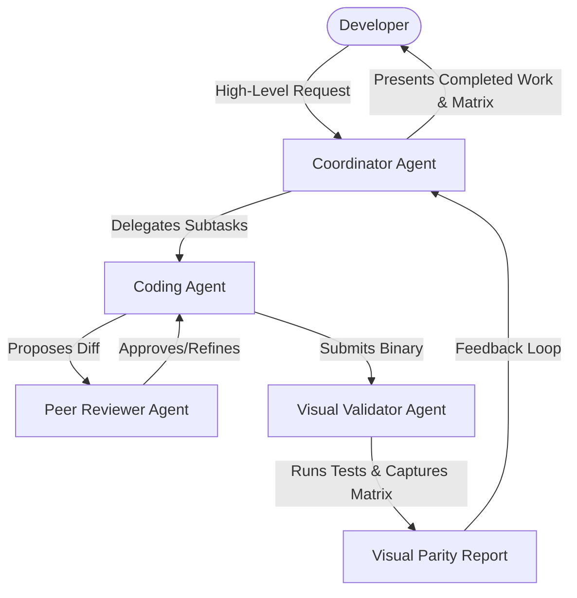

# Strategic Design Report: Multi-Agent Team Architecture for `project-ng`
## Optimizing Workspace Collaboration via the `.agents/` Customization Framework

---

## 1. Executive Summary

As `project-ng` (the 3dfx Glide Emulation Wrapper) matures, the complexity of managing state translation, hardware-close API emulation, and multi-backend synchronization increases. To scale development, prevent regressions, and enforce architectural integrity, we propose a **Multi-Agent Team Architecture** built directly on top of the `.agents/` workspace customization framework.

By defining specialized rules, triggers, and skills, we can transform a single AI coding assistant into a collaborative team of autonomous agents:
*   **The Coordinator Agent**: Orchesrates the workflow, plans tasks, and delegates work.
*   **The Specialized Coder (with Backend Skills)**: Focuses on surgical, high-quality code changes.
*   **The Peer Reviewer Agent**: Guards the architecture, enforces DRY, and checks for state leaks.
*   **The Visual Validator Agent (QA)**: Automates headless compilation, stdin-piping execution, and screen captures.

This report analyzes the optimal granularity for these agents, defines their roles, and outlines a seamless, day-to-day developer workflow.

---

## 2. Multi-Agent Team Roles & Responsibilities



### A. The Coordinator Agent (The Orchestra Conductor)
*   **Role**: The central interface for the developer. It acts as the product manager and technical lead.
*   **Responsibilities**:
    1.  Receives high-level requests (e.g., "Implement FogCoord support in Vulkan and Software backends").
    2.  Performs initial repository analysis and writes a step-by-step **Implementation Plan**.
    3.  Spawns and delegates subtasks to the Coder agent.
    4.  Routes proposed code changes to the Peer Reviewer for architectural approval.
    5.  Delegates verification to the Visual Validator to generate comparative screenshots.
    6.  Assembles the final results, validates logs, and presents the completed work to the developer.

### B. The Peer Reviewer Agent (The Architect & Guardian of DRY)
*   **Role**: A highly critical, paranoid code-quality gatekeeper. It does **not** write code; it only critiques and refines.
*   **Responsibilities**:
    1.  **DRY (Don't Repeat Yourself) Enforcement**: Analyzes proposed diffs to ensure common code (such as vertex parameter sanitization or logging utilities) is shared in `src/core/` rather than duplicated inside individual backends.
    2.  **Memory & Pointer Safety**: Inspects raw pointer usage, staging buffer management (e.g., LFB locking pipelines), and memory boundaries to prevent segfaults or leaks on modern GPUs.
    3.  **State Synchronization Checks**: Specifically audits state serialization (`grGlideGetState`/`grGlideSetState`) to ensure any newly introduced state variables (like culling modes, chromakeying, or depth ranges) are correctly saved, restored, and pushed to the active backend—preventing the silent state leaks that caused our previous culling and splash-screen bugs.

### C. The Visual Validator Agent (The QA Oracle)
*   **Role**: An automation-heavy quality assurance specialist.
*   **Responsibilities**:
    1.  Compiles the wrapper and test suites cleanly under sandboxed environments.
    2.  Deploys the timed **Stdin Piping Pipeline** to headlessly control interactive tests (feeding keys to cycle modes).
    3.  Resolves display server tokens and captures target windows using exact, backend-mapped titles and strict timeout watchdogs.
    4.  Generates the high-fidelity `visual_matrix_report.md` containing comparative back-to-back carousels.

---

## 3. Granularity Analysis: One Coder vs. Per-Backend Coders

We analyzed whether we should define a separate coding agent for each backend (e.g., a Vulkan Coder, a GLES Coder, and a Software Coder) versus a single, unified Coder Agent equipped with modular backend skills.

### Pros & Cons Matrix

| Architecture | Pros | Cons |
| :--- | :--- | :--- |
| **Option A: Granular Coders** *(An agent per backend: `vulkan-coder`, `gles-coder`, `software-coder`)* | *   **Extreme Specialization**: Each agent has an isolated, hyper-focused prompt containing only the API rules of its specific target (Vulkan barriers, GLES shaders, or Software loop optimizations).<br>*   **Safety**: Zero risk of Vulkan logic bleeding into GLES code or software loops. | *   **Frontend Blindness**: Emulating Glide requires translating frontend entry points (in `src/glide3/`) into backend structures. Separate agents will struggle to maintain symmetry between the frontend layout and backend rendering pipelines.<br>*   **High Context Overhead**: Splitting the coder requires frequent hand-offs, increasing token usage and conversation latency.<br>*   **Anti-Pattern Fragility**: Promotes siloed codebases, making code-duplication (anti-DRY) highly likely. |
| **Option B: Unified Coder** *(A single `coding-agent` utilizing dynamic **Workspace Skills**)* | *   **Holistic Architectural View**: The coder understands both the Glide frontend entry points and how they connect to the backend wrappers, ensuring symmetrical state translation.<br>*   **Surgical Specialization**: Through `.agents/skills/`, the coder dynamically loads Vulkan rules *only* when editing Vulkan files, and Software math *only* when editing Software files.<br>*   **High Token Efficiency**: Keeps the active prompt compact by loading backend rules on demand. | *   Requires robust prompt-engineering to guarantee the agent correctly isolates backend-specific logic when switching between files during a multi-backend task. |

### Strategic Recommendation: **Option B (The Hybrid Unified Coder)**
We strongly recommend **Option B**. A single, unified Coding Agent is far superior because Glide wrapper development is highly symmetrical: a change in the frontend layout *must* be accompanied by corresponding decoders in the backends. 

By utilizing **Workspace Skills** (e.g., `.agents/skills/vulkan-expert/`), we get the best of both worlds: a coder that maintains a holistic view of the wrapper architecture, but instantly gains deep, hyper-specialized Vulkan or Software expertise the moment it touches files inside those directories.

---

## 4. Day-to-Day Workflow & Interface

In your daily development loop, you will interact with this agent team seamlessly inside your IDE. The platform manages their lifecycles automatically using **triggers**, **slash commands**, and **coordinated delegation**.

### A. How They Are Enabled & Invoked
You do **not** need to manually enable or manage individual subagents. The platform uses two main activation methods:

1.  **Auto-Activation (Context Triggers)**:
    *   When you open a file under `src/backends/vulkan/` or type a prompt containing `"Vulkan"`, the platform automatically loads the `vulkan-expert` skill rules and attaches them to your active conversation. 
    *   This is completely invisible and zero-friction.
2.  **Slash Commands & Multi-Agent Mode**:
    *   **`/owl`**: Invokes the multi-agent orchestrator. Use this when launching a complex, multi-backend feature. Owl automatically spawns the Coordinator, delegates tasks to the Coder, routes patches to the Peer Reviewer, and invokes the Validator.
    *   **`/plan`**: Asks the Coordinator to write a step-by-step implementation plan and architectural assessment before writing any code.
    *   **`/teamwork-preview`**: Previews the planned subagent hand-offs and tasks for your review.

### B. Step-by-Step Developer Workflow Example

Here is how you will work with the agent team on a day-to-day basis:

```
[Developer] ──> Type in Chat: 
                "/owl Implement FogCoord support in Vulkan and Software backends."
                     │
                     ▼
[Coordinator] ──> Analyzes code, writes the plan, and spawns Coder.
                     │
                     ▼
[Coder] ──> Loads "vulkan-expert" and "software-oracle" skills.
        ──> Writes the frontend state mapping and backend decoders.
        ──> Sends the proposed patch to Peer Reviewer.
                     │
                     ▼
[Peer Reviewer] ──> Audits the patch:
                * Checks that the new FogCoord state is correctly saved/restored
                  in grGlideGetState/SetState (preventing state leaks).
                * Verifies no duplicate code is introduced.
                * Approves and sends to Validator.
                     │
                     ▼
[Validator] ──> Compiles wrapper.
            ──> Runs refs/glide/glide3x/h3/glide3/tests/test34.exe.
            ──> Deploys timed stdin pipe: (sleep 7; echo -n "f") | test34.exe
            ──> Captures Vulkan and Software screenshots.
            ──> Verifies 100% visual parity and generates the matrix report.
                     │
                     ▼
[Coordinator] ──> Presents the final approved code changes, clean compile logs,
                  and the gorgeous comparative visual matrix to the Developer.
```

---

## 5. Implementation Plan: Building the `.agents/` Folder

To implement this architecture immediately, we will create the following files under the `.agents/` directory:

### A. The Team Manifest (`.agents/AGENTS.md`)
This file defines the team roles, the global repository rules (TDD mandates, submodules ban), and coordinates how the subagents hand off tasks.

### B. The Specialized Skills Directory
We will create three workspace skills that are auto-loaded based on file path triggers:
1.  **`.agents/skills/vulkan-expert/SKILL.md`**: Active on `src/backends/vulkan/` or `Vulkan` queries.
2.  **`.agents/skills/rasterizer-oracle/SKILL.md`**: Active on `src/backends/software/` or `Software` queries.
3.  **`.agents/skills/visual-validator/SKILL.md`**: Active on `tests/` or `visual` queries, containing our headless capture tools and stdin-piping scripts.

---

## 6. Open Strategic Decisions for Your Review

Before we generate the file templates and write them to the workspace, please review the following architectural decisions:

1.  **Peer Reviewer Strictness**: Should the Peer Reviewer agent block the workflow and request corrections automatically if it detects any duplicate code (strict DRY enforcement), or should it present a warning and let the Coordinator proceed?
2.  **Validator Scope**: During normal development, should the Validator run the *entire* test suite (test00 to test39) across all backends (which takes about 45 seconds headlessly), or should it dynamically target only the tests relevant to the files changed (e.g., running only `test34` when fogging or vertex layouts are modified)?
3.  **Activation Mode**: Are you ready for me to create the `.agents/` folder and write these team rules and skills to make them active in your workspace right away?
