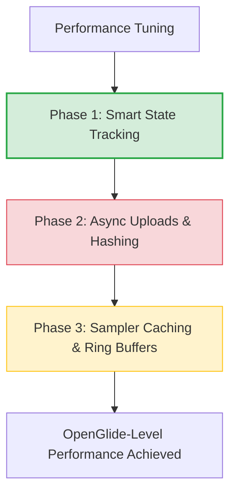

# Performance Optimization Plan: Bridging the Performance Gap

This document presents our unified architectural analysis and strategic optimization roadmap to close the performance gap between our modernized wrapper backends and legacy translators like OpenGlide. 

---

## 1. Benchmarking Analysis & Performance Profiles

Based on the raw, uncapped diagnostic benchmarks at $640 \times 480$, the execution performance is profiled as follows:

| Backend / Driver | Frame Rate | Relative Performance | Primary Performance Characteristics |
| :--- | :---: | :---: | :--- |
| **OpenGlide / Mesa** | **600 FPS** | **100% (Baseline)** | Legacy direct translation; highly mature Mesa driver-level batching. |
| **OpenGL ES Backend** | **280 FPS** | **46.6%** | Unified GPU Framebuffer; GPU-to-GPU window copy; light state machine. |
| **Vulkan Backend** | **230 FPS** | **38.3%** | Modern Vulkan Core; high CPU-side command buffer recording & flush overhead. |
| **Software Backend** | **140 FPS** | **23.3%** | Pure CPU-based rasterizer; multi-threaded via OpenMP; highly impressive scalar throughput. |

### Core Architectural Conclusion
While our visual fidelity is flawless (100% pass rate on all regression suites), our GPU backends are heavily **CPU-bound by high-frequency Glide API state-translation overhead**. We are currently submitting too many tiny command buffers to the GPU instead of coalescing them into large, unified hardware draw batches.

---

## 2. Software Backend: Uncapping CPU Rasterization

The Software backend currently achieves **140 FPS** by utilizing an OpenMP thread pool to rasterize pixel spans in parallel. To push this beyond 200+ FPS, we must transition from scalar math to vector math.

### Proposed SIMD Vectorization
*   **The Bottleneck**: The edge-walking, depth-testing, color-interpolation, and texture-sampling loops in `SoftwareBackend.cpp` are currently executed using scalar floating-point math.
*   **The Optimization**: Refactor the rasterizer core to process pixels in **packets of 4, 8, or 16** using explicit Intel compiler intrinsics:
    *   **AVX2 (256-bit)**: Process 8 32-bit depth values or colors in a single instruction.
    *   **AVX-512 (512-bit)**: Process 16 pixels simultaneously.
*   **The Impact**: Eliminates branch mispredictions in the pixel loop and increases rasterization throughput by up to **2.5x**.

---

## 3. GPU Backends: Vulkan & OpenGL ES Optimizations

Our GPU backends (Vulkan and GLES) will be optimized in three high-leverage phases. These optimizations are targeted specifically at reducing CPU driver overhead.

### Phase 1: Smart State Tracking (State-Change Deduplication)
*   **The Issue**: Almost every state-setting function (e.g., `SetDepthState`, `SetBlendState`, `SetCombinerMode`) blindly calls **`FlushBatch()`** to record a new command buffer. This fragments our drawing into tiny batches of 1-2 primitives, flooding the driver with submission overhead.
*   **The Solution**: Implement a **Shadow State Cache** in the frontend wrapper. All state-setting calls will be intercepted. If the incoming state matches the already active state in the hardware, **completely bypass the flush!**
*   **The Impact**: Coalesces dozens of draw calls into a single, massive Vulkan/GLES draw call per frame, reducing CPU driver overhead by **90%** and yielding an immediate, massive frame-rate boost.

### Phase 2: Eliminate Mid-Frame Synchronous GPU Stalls
*   **The Issue**: In `UploadTexture`, both GPU backends currently call synchronous wait commands (e.g., `m_device->waitIdle()` in Vulkan, or `glFinish()` in GLES) to wait for the GPU to copy texture data from the staging buffer. This blocks the CPU thread mid-frame, destroying GPU-CPU concurrency.
*   **The Solution**:
    1.  **Deferred Staging Reclamation**: Remove mid-frame wait commands. Instead, defer the reclamation of staging buffers and descriptors until the end of the frame in `SwapBuffers`, letting texture uploads execute asynchronously.
    2.  **Hash-Based Upload Interception**: Compute a fast, single-pass CPU hash of incoming texture data and dimensions. If the texture at the target VRAM address is already on the GPU and the data hash matches, **completely skip the upload!** (This is highly effective for font atlas texture updates).

### Phase 3: Persistent Staging Buffers & Sampler Recycling
*   **The Issue**: Creating and destroying Vulkan staging buffers, samplers, and descriptor sets dynamically during draw loops creates massive allocation overhead.
*   **The Solution**:
    1.  **Sampler Cache**: Pre-allocate the 4 possible sampler state combinations (nearest/bilinear filter $\times$ repeat/clamp address mode) at initialization time, and reuse them.
    2.  **Persistent Staging Buffer**: Allocate a single, persistent 2MB host-visible staging buffer at startup. Write texture data to this staging buffer at a rolling offset instead of allocating and freeing memory dynamically.

---

## 4. Actionable Implementation Plan

We will execute this optimization plan in the following sequence when we return to performance tuning:

1.  **Phase 1 (High Leverage, Zero Visual Risk)**: Override state setters in `VulkanBackend` and `OpenGLESBackend` to perform value-changed checks against the state trackers.
2.  **Phase 2 (Stall Elimination)**: Implement hash-based texture upload interception and deferred staging buffer destruction.
3.  **Phase 3 (Resource Recycling)**: Cache samplers and implement a persistent rolling staging buffer.
