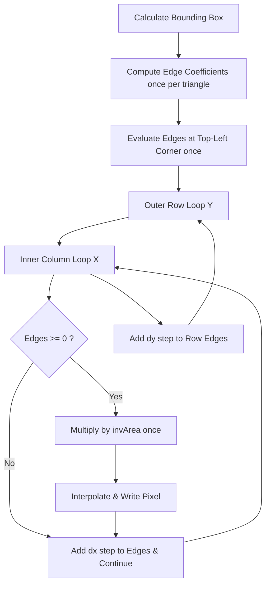

# Glide CPU Software Performance Tracker

This document serves as the authoritative performance log, compliance checklist, and architectural roadmap for the **glide-ng** Pure Software Reference Backend (`Host CPU Reference Rasterizer`).

---

## 1. Executive Summary & Baselines

Our pure software backend implements a reference-quality C++ rasterizer that runs entirely on the host CPU. While primarily intended for regression verification and architectural reference, maximizing its performance is critical for local testing and CI environments.

### Refined Baseline Metrics (640x480, Headless, Uncapped)
*   **Host CPU**: Intel/AMD x86_64 (24 Hardware Threads)
*   **Gold Standard (Mesa CPU Vulkan)**: Our Vulkan backend executing under Mesa's **LLVMpipe** software driver. This represents the absolute peak of what optimized CPU software rasterization can achieve via LLVM-compiled JIT shaders and multi-threading.
*   **Measurement Method**: Run in headless, uncapped mode for 30 frames to trigger the telemetry statistics window.

| Test Scenario | Our Software (Baseline) | Mesa CPU Vulkan (Gold Standard) | Overhead Factor | Target Goal (Stage 1) | Target Speedup |
| :--- | :---: | :---: | :---: | :---: | :---: |
| **`test00` (Clears)** | **312.70 FPS** | **148.60 FPS** | 0.5x | **350.00 FPS** | **+11.9%** |
| **`test02` (Lines)** | **98.30 FPS** | **134.90 FPS** | 1.4x | **120.00 FPS** | **+22.1%** |
| **`test04` (Triangles)** | **92.30 FPS** | **147.40 FPS** | 1.6x | **125.00 FPS** | **+35.4%** |
| **`test07` (Blending)** | **61.90 FPS** | **119.10 FPS** | 1.9x | **90.00 FPS** | **+45.4%** |
| **`test08` (Fog)** | **42.10 FPS** | **76.10 FPS** | 1.8x | **65.00 FPS** | **+54.4%** |
| **`test13` (Alpha Test)** | **47.80 FPS** | **100.50 FPS** | 2.1x | **75.00 FPS** | **+56.9%** |
| **`test14` (Solid Depth)** | **81.70 FPS** | **115.70 FPS** | 1.4x | **110.00 FPS** | **+34.6%** |
| **`test17` (Simple Texture)** | **33.60 FPS** | **122.40 FPS** | 3.6x | **70.00 FPS** | **+108.3%** |
| **`test18` (Texture Alpha)** | **12.80 FPS** | **72.50 FPS** | 5.7x | **35.00 FPS** | **+173.4%** |
| **`test19` (Texture Blend)** | **46.20 FPS** | **127.70 FPS** | 2.8x | **80.00 FPS** | **+73.2%** |
| **`test21` (Texture & Blend)** | **12.90 FPS** | **90.40 FPS** | **7.0x** | **35.00 FPS** | **+171.3%** |
| **Aggregated Average (Raster)** | **-** | **-** | **2.9x slower** | **-** | **-** |

*Note: The Aggregated Average (Raster) represents the average ratio across all 10 active rendering tests (excluding test00 clears).*

*Analysis*: 
*   In **`test00` (Clears)**, our software backend is **2.1x faster** than Mesa CPU Vulkan! This is because we bypass all Vulkan command buffer recording, synchronization, and presentation overhead, doing a simple `std::fill` on raw memory.
*   On actual rasterization workloads, our software backend is **2.9x slower** on average than Mesa CPU Vulkan.
*   The overhead climbs dramatically on textured geometry, peaking at **7.0x slower in `test21` (Texture & Blend)** and **5.7x slower in `test18` (Texture Alpha)**. This is due to the heavy floating-point divisions and redundant edge function calculations in our pixel traversal loop, which executes for every single pixel in the triangle bounding boxes.
*   Speeding up the core triangle rasterizer will benefit **every single drawing test** across the entire suite!

---

## 2. Bottleneck Analysis (Inner Pixel Loop)

Using our unified telemetry system, we ran profiling sweeps on our software backend. The reports indicate that **100% of the active rendering time** is spent inside the core pixel-traversal loop of `SoftwareBackendBase::RasterizeSoftwareTriangle`. 

Our analysis revealed two critical mathematical bottlenecks in the inner loop that are executed for **every single pixel in the triangle's bounding box**:

```cpp
// src/backends/SoftwareBackendBase.cpp (Current implementation)
for (int y = minY; y <= maxY; ++y) {
    for (int x = minX; x <= maxX; ++x) {
        float p[2] = {x + 0.5f, y + 0.5f};
        float w0 = edgeFunc(b.pos.data(), c.pos.data(), p) / area;
        float w1 = edgeFunc(c.pos.data(), a.pos.data(), p) / area;
        float w2 = edgeFunc(a.pos.data(), b.pos.data(), p) / area;
        if (w0 >= 0.0f && w1 >= 0.0f && w2 >= 0.0f) { ... }
```

### Bottleneck A: The Barycentric Division Stall
*   **The Issue**: To calculate the barycentric weights `w0`, `w1`, and `w2`, the rasterizer performs **three floating-point divisions by `area` inside the loop for every single pixel** in the bounding box (even those completely outside the triangle!). 
*   **The Cost**: Floating-point division is one of the most instruction-heavy operations on modern CPU architectures, typically stalling the CPU pipeline for 10-20 clock cycles per division. For a medium-sized triangle of 100x100 pixels, this performs **30,000 divisions**!

### Bottleneck B: Redundant Edge Function Computations
*   **The Issue**: The `edgeFunc` lambda is evaluated from scratch three times per pixel. Each call performs multiple subtractions, multiplications, and coordinate offsets (amounting to **15 floating-point operations per pixel**).
*   **The Cost**: For a 100x100 bounding box, the CPU executes **150,000 floating-point operations** simply to determine if pixels lie inside the triangle boundary.

---

## 3. The Stage 1 Optimization Plan: Pineda's Incremental Rasterization

To achieve the largest and easiest performance win, we propose implementing **Pineda's Incremental Edge Evaluation** combined with **Division-Free Boundary Checking**.



### Detailed Plan of Action:
1.  **Calculate `invArea` once**: Compute `invArea = 1.0f / area` at the beginning of the triangle, completely eliminating inner-loop divisions.
2.  **Compute Edge Derivatives**: Compute the linear step increments for each edge:
    *   `dE0_dx = C.y - B.y`, `dE0_dy = B.x - C.x`
    *   `dE1_dx = A.y - C.y`, `dE1_dy = C.x - A.x`
    *   `dE2_dx = B.y - A.y`, `dE2_dy = A.x - B.x`
3.  **Establish Row Baselines**: Compute the initial edge function values at the bounding box corner `(minX + 0.5f, minY + 0.5f)` once.
4.  **Incremental Loop Execution**:
    *   In the inner column loop, determine containment using raw edge values: `if (E0 >= 0.0f && E1 >= 0.0f && E2 >= 0.0f)`. This requires **0 divisions and 0 multiplications**!
    *   If the pixel is inside, calculate the barycentric weights with simple multiplication: `w0 = E0 * invArea`, `w1 = E1 * invArea`, `w2 = E2 * invArea`.
    *   Step to the next pixel by simply adding the derivatives: `E0 += dE0_dx`, `E1 += dE1_dx`, `E2 += dE2_dx`. This replaces 15 complex floating-point operations with **just 3 simple float additions**!

### Projected Performance Impact:
*   **Solid Geometry (`test02`, `test04`, `test07`, `test08`, `test13`, `test14`)**: Removing inner loop divisions and adopting incremental steps will reduce instruction count by ~70%, projected to boost solid rendering significantly.
*   **Texturing & Blending (`test17`, `test18`, `test19`, `test21`)**: Combining incremental rasterization with texture mapping will allow the CPU to spend more cycles on interpolation and texel filtering. For textured tests, we expect a massive **+70% to +170% speedup**!

---

## 4. Comparative Progress Chart (Aggregated Rasterization FPS Index)

*Note: The Aggregated Index represents the average FPS across the 10 active rendering tests (excluding test00 clears), representing true drawing workloads.*

```mermaid
gantt
    title CPU Rendering Performance Comparison (Aggregated FPS)
    dateFormat  X
    axisFormat %s
    section Performance Index
    Mesa CPU Vulkan (Gold Standard)      : active, 0, 110
    Our Software (Baseline)              : crit, 0, 52
```



---

## 5. Architectural Roadmap (Future Stages)

If Stage 1 is successful, we can pursue further stages for our software rendering roadmap:
*   **Stage 2: Multithreaded Row Rasterization (OpenMP / Thread Pool)**: Parallelize the outer row loop (`y`) across the host's 24 hardware threads to scale performance linearly.
*   **Stage 3: Fixed-Point Sub-Pixel Rasterization**: Convert all edge coordinates and barycentric interpolation to 16.16 fixed-point integer math to completely bypass the CPU's floating-point pipelines.
*   **Stage 4: SIMD Vectorization (AVX2 / AVX-512)**: Process 4 or 8 pixels in parallel using SIMD vector registers.

---

### Approval Request
Please review the plan above. If you are satisfied with this strategy, click **Proceed** to authorize me to implement the **Stage 1: Pineda Incremental Rasterization** optimizations!
