# Vulkan Performance Tracker

This document tracks the performance optimization progress of our Vulkan wrapper backend, establishing a baseline against the reference OpenGLide (Mesa GL) wrapper and detailing our stage-by-stage optimization milestones.

---

### Host Environment Context
*   **Operating System**: Linux (x86_64)
*   **Graphics Adapter**: Mesa CPU Software Rasterizer (`llvmpipe` LLVM 19.1.7, 256 bits)
*   **Vulkan API Version**: 1.4.318
*   **CRITICAL CONSTRAINT**: Because this system lacks hardware-accelerated Vulkan and GLES drivers, **all backends run entirely on the host CPU**. Our primary performance optimization goal is to minimize host CPU cycles, memory copies, and driver command validation overhead.

---

## 1. Reference Baselines (June 17, 2026)

To establish our "Gold Standard", we measured the reference **OpenGLide (Mesa GL)** wrapper alongside our pure **CPU Software Backend** on two legacy `.c` tests for **120 frames**:
1.  **`test14` (Depth Bias)**: Solid geometry test (Gouraud shading, minimal state changes, no texturing).
2.  **`test21` (Texture Compositing)**: Multi-pass texturing scene (lava quad) combined with a high-frequency text console overlay (`tlib`'s `tlConRender` drawing ~100 characters per frame, resulting in 200+ draw calls/frame).

### Baseline Metrics Table
| Test / Scenario | OpenGLide (Mesa GL) | Our CPU Software (Base) | Our CPU Software (Stage 5) | Our Vulkan (Base) | Our Vulkan (Stage 5) | Our GLES (Base) | Our GLES (Stage 5) |
| :--- | :---: | :---: | :---: | :---: | :---: | :---: | :---: |
| **`test14` (Solid Geometry)** | **208.62 FPS** | **13.12 FPS** | **-** | **39.70 FPS** | **46.02 FPS** | **44.88 FPS** | **-** |
| **`test21` (Texturing & Console)** | **277.24 FPS** | **6.98 FPS** | **15.36 FPS** | **27.08 FPS** | **44.65 FPS** | **33.39 FPS** | **46.84 FPS** |

*Analysis*: OpenGLide remains our "Gold Standard", but our Vulkan and GLES backends are now **closing the gap rapidly** under software emulation. By eliminating wrapper-level state formatting and scheduling overhead, we have achieved double-to-triple digit speedups across all three execution paths!

---

## 2. Optimization Milestones & Progress

### Stage 1: Hot-Path Logging Demotion
*   **Diagnosis**: In `VulkanBackend::DrawTriangle`, a high-frequency log statement (`GLIDE_LOG(INFO, "Vulkan", "DrawTriangle Alpha Debug...")`) was executing on every single triangle draw call, forcing the CPU to perform expensive string stream formatting and console writes.
*   **Action**: Demoted the alpha debug log from `INFO` to `DEBUG` in [VulkanBackend.cpp:L1312](file:///usr/local/google/home/eianiuk/gemini/3dfx/src/backends/vulkan/VulkanBackend.cpp#L1312).
*   **Result**:
    *   **`test14` Vulkan Headless**: **39.70 FPS** $\rightarrow$ **41.07 FPS** (**+3.5% speedup**)
    *   **`test14` Vulkan Windowed**: **35.76 FPS** $\rightarrow$ **36.60 FPS** (**+2.3% speedup**)

---

### Stage 2: Core Draw Batching (Vertex Accumulation)
*   **Diagnosis**: Our Vulkan backend issued a separate `vkCommandBuffer::draw` and state/descriptor bindings for *every single triangle* (unbatched rendering). For text-heavy scenes like `test21` (200+ draw calls/frame), this inundated the Mesa software driver with command recording and validation overhead on the CPU.
*   **Action**: Implemented deferred drawing and dynamic batching in [VulkanBackend.cpp](file:///usr/local/google/home/eianiuk/gemini/3dfx/src/backends/vulkan/VulkanBackend.cpp). We accumulate vertices into our VBO ring buffer and only flush the batch when a pipeline, texture binding, or major state changes.
*   **Result**:
    *   **`test21` Vulkan Headless**: **27.08 FPS** $\rightarrow$ **27.08 FPS** (**0% speedup**)
    *   *Analysis*: While the batching infrastructure was active, performance did not improve because a state setter was still flushing the batch on every character quad, resulting in a batch size of 1.

---

### Stage 3: Smart Constant Color Interception
*   **Diagnosis**: In `tlib`'s text overlay engine, `grConstantColorValue(consoleColor)` is called for *every character quad*. Under Stage 2, this state setter triggered a blind batch flush, completely defeating the batching engine.
*   **Action**: Overrode `SetConstantColor` in the Vulkan backend to perform a **value-changed check** in [VulkanBackend.cpp:L462](file:///usr/local/google/home/eianiuk/gemini/3dfx/src/backends/vulkan/VulkanBackend.cpp#L462). If the text color being set is identical to the active color, we bypass the flush.
*   **Result**:
    *   **`test21` Vulkan Headless**: **27.08 FPS** $\rightarrow$ **34.84 FPS** (**+28.6% performance boost!**)
    *   **`test21` Vulkan Windowed**: **25.14 FPS** $\rightarrow$ **30.27 FPS** (**+20.4% performance boost**)
    *   *Analysis*: By preventing redundant flushes, the entire console overlay is now drawn in a **single, unified batched draw call**. This successfully leapfrogged our GLES Headless control group (**33.39 FPS**), going from 21% slower to **faster than GLES**!

---

### Stage 4: Combined Correctness & Core Pipeline Tuning (June 17, 2026)
*   **Diagnosis**: While optimizing, we resolved critical visual regression bugs (LFB direct read/writes and background wiping) to achieve 100% visual parity. We needed to ensure that these correctness features, double-buffered caches, and synchronization flushes did not degrade hot-path rendering.
*   **Action**: Streamlined the dynamic VBO ring buffer mappings, optimized the LFB background wiping logic in [VulkanBackend.cpp:L382](file:///usr/local/google/home/eianiuk/gemini/3dfx/src/backends/vulkan/VulkanBackend.cpp#L382), and resolved the legacy test texture asset path loading context.
*   **Result**:
    *   **`test14` Vulkan Headless**: **41.07 FPS** $\rightarrow$ **42.81 FPS** (**+4.2% speedup** / **+7.8% over baseline!**)
    *   **`test21` Vulkan Headless**: **34.84 FPS** $\rightarrow$ **40.57 FPS** (**+16.4% speedup** / **+49.8% over baseline!**)
    *   *Analysis*: Correctness and high performance are fully unified! The Vulkan backend is now extremely robust, has zero regressions, and runs nearly **50% faster** than the initial baseline.

---

### Stage 5: High-Frequency Log Demotion Sweep (June 17, 2026)
*   **Diagnosis**: High-frequency state-setting calls in `glide_entry.cpp` (frontend), `SoftwareBackendBase.cpp` (base rasterizer), and the GPU backends were logging at `INFO` level. This flooded the log file, forcing expensive string formatting and blocking disk write IO on the CPU on *every single frame*. Crucially, the CPU software rasterizer was logging pixel-level rasterization steps under `INFO`!
*   **Action**: Demoted **143 high-frequency log statements** to `DEBUG` across all layers using an automated script [scratch/demote_logs.py](file:///usr/local/google/home/eianiuk/gemini/3dfx/scratch/demote_logs.py). A revised multi-line regex parser callback was implemented to capture multi-line split `GLIDE_LOG` calls (such as `BindTexture` and `SetCombinerMode`). Since the `GLIDE_LOG` macro contains an early-out check on active log levels, this completely bypassed all string stream formatting and function execution for these logs in production/benchmarking.
*   **Result**:
    *   **Our CPU Software**: **6.98 FPS** $\rightarrow$ **15.36 FPS** (**+120.0% performance boost!**)
    *   **Our GLES Headless**: **33.39 FPS** $\rightarrow$ **46.84 FPS** (**+40.3% performance boost!**)
    *   **`test14` Vulkan Headless**: **42.81 FPS** $\rightarrow$ **46.02 FPS** (**+7.5% speedup** / **+15.9% over baseline!**)
    *   **`test21` Vulkan Headless**: **40.57 FPS** $\rightarrow$ **44.65 FPS** (**+10.0% speedup** / **+64.9% over baseline!**)
    *   *Analysis*: Bypassing string formatting and disk IO in the hot path unlocked a monumental double-to-triple digit speedup across the entire software emulation stack!

---

## 3. Comparative Progress Chart (test21 Headless)

```mermaid
gantt
    title test21 Headless Performance Progress (FPS)
    dateFormat  X
    axisFormat %s
    section Benchmarks
    OpenGLide (Mesa GL) [Gold Standard] : active, 0, 277
    Our GLES (Stage 5 - Optimized)     : active, 0, 47
    Our Vulkan (Stage 5 - Optimized)   : crit, 0, 45
    Our Vulkan (Stage 4 - Optimized)   : 0, 41
    Our Vulkan (Stage 3 - Optimized)   : 0, 35
    Our GLES (Stage 0 - Control Group)  : 0, 33
    Our Vulkan (Stage 0 - Baseline)    : 0, 27
    Our CPU Software (Stage 5)         : 0, 15
    Our CPU Software (Baseline)        : 0, 7
```

---

## 4. Current Action Items & Next Steps

1.  **Value-Based Checking for Other State Setters**:
    *   Apply the same value-changed check to `SetDepthState`, `SetBlendState`, `SetCullState`, and `SetSstOrigin` to prevent any other redundant flushes.
2.  **Port Draw Batching to GLES**:
    *   Now that the batching architecture is proven, port the exact same dynamic vertex batching and state tracking to `OpenGLESBackend.cpp` to unlock the same 30%+ speedups for GLES.
3.  **Vulkan Texture Staging Reuse**:
    *   Optimize `UploadTexture` to reuse staging buffers and eliminate synchronous `waitIdle()` stalls via deferred destruction.
