# Vulkan Performance Tracker

This document tracks the performance optimization progress of our Vulkan wrapper backend, establishing a baseline against the reference OpenGLide (Mesa GL) wrapper and detailing our stage-by-stage optimization milestones.

---

### Host Environment Context
*   **Operating System**: Linux (x86_64)
*   **Graphics Adapter**: Mesa CPU Software Rasterizer (`llvmpipe` LLVM 19.1.7, 256 bits)
*   **Vulkan API Version**: 1.4.318
*   **CRITICAL CONSTRAINT**: Because this system lacks hardware-accelerated Vulkan and GLES drivers, **all backends run entirely on the host CPU**. Our primary performance optimization goal is to minimize host CPU cycles, memory copies, and driver command validation overhead.

---

## 1. Reference Baselines (June 17, 2026)

To establish our "Gold Standard", we measured the reference **OpenGLide (Mesa GL)** wrapper alongside our pure **CPU Software Backend** on two legacy `.c` tests for **120 frames**:
1.  **`test14` (Depth Bias)**: Solid geometry test (Gouraud shading, minimal state changes, no texturing).
2.  **`test21` (Texture Compositing)**: Multi-pass texturing scene (lava quad) combined with a high-frequency text console overlay (`tlib`'s `tlConRender` drawing ~100 characters per frame, resulting in 200+ draw calls/frame).

#### Baseline Metrics Table (True Uncapped Rendering Speed)
| Test / Scenario | OpenGLide (Mesa GL) | Our CPU Software (Base) | Our CPU Software (Stage 5) | Our Vulkan (Base) | Our Vulkan (Stage 6) | Our GLES (Base) | Our GLES (Stage 5) |
| :--- | :---: | :---: | :---: | :---: | :---: | :---: | :---: |
| **`test14` (Solid Geometry)** | **208.62 FPS** | **16.79 FPS** | **-** | **117.37 FPS** | **217.38 FPS** | **177.93 FPS** | **-** |
| **`test21` (Texturing & Console)** | **277.24 FPS** | **7.90 FPS** | **20.42 FPS** | **49.35 FPS** | **184.12 FPS** | **75.24 FPS** | **212.76 FPS** |

*Analysis*: By lifting the artificial 60 FPS (16.66 ms) frame-pacing sleep ceiling, the true raw speed of our modernized pipelines has been unleashed! 
*   **Vulkan `test14`**: Runs at **217.38 FPS**, officially **beating our OpenGLide "Gold Standard" (208.62 FPS)** natively under software CPU emulation!
*   **Vulkan `test21`**: Runs at **184.12 FPS**, achieving a colossal **+273.1% speedup** over its starting baseline (49.35 FPS)!
*   **OpenGL ES `test21`**: Runs at **212.76 FPS**, achieving a spectacular **+182.7% speedup** over its starting baseline (75.24 FPS)!

---

## 2. The 60 FPS / 16.66 ms Frame-Pacing Ceiling Discovery (June 17, 2026)
During Stage 6, we noticed that both Vulkan and GLES benchmarks on `test21` were stubbornly hovering around **44–46 FPS** despite massive architectural improvements. A deep-dive investigation into the log file revealed:
`Target Presentation  : 60 FPS`

Inside every backend's `SwapBuffers()` presentation phase, we had a default, hardcoded frame pacing ceiling active:
```cpp
if (m_config.maxFps > 0.0f) {
    auto delay = std::chrono::microseconds(static_cast<int>(1000000.0f / m_config.maxFps));
    std::this_thread::sleep_for(delay);
}
```
Because `maxFps` defaults to `60.0f`, the wrapper **slept the CPU main thread for exactly 16.66 ms on every single frame**, adding a huge constant delay that completely compressed our rendering speedups.

*   **Action**: Upgraded [JsonConfigLoader.cpp](file:///usr/local/google/home/eianiuk/gemini/3dfx/src/core/JsonConfigLoader.cpp) to parse `"maxFps"` from the JSON profile, and added the `GLIDE_WRAPPER_MAX_FPS` environment variable override.
*   **Result**: By setting `GLIDE_WRAPPER_MAX_FPS=0` during benchmarking, we completely bypassed the pacing sleep, instantly unlocking the true rendering performance of our emulation stack!

---

## 3. Optimization Milestones & Progress (Uncapped)

### Stage 1: Hot-Path Logging Demotion
*   **Diagnosis**: In `VulkanBackend::DrawTriangle`, a high-frequency log statement was executing on every single triangle draw call, forcing the CPU to perform expensive string stream formatting and console writes.
*   **Action**: Demoted the alpha debug log from `INFO` to `DEBUG` in [VulkanBackend.cpp:L1312](file:///usr/local/google/home/eianiuk/gemini/3dfx/src/backends/vulkan/VulkanBackend.cpp#L1312).
*   **Result**:
    *   **`test14` Vulkan Headless (Uncapped)**: **117.37 FPS** → **127.38 FPS** (**+8.5% speedup**)

---

### Stage 2: Core Draw Batching (Vertex Accumulation)
*   **Action**: Implemented deferred drawing and dynamic batching in [VulkanBackend.cpp](file:///usr/local/google/home/eianiuk/gemini/3dfx/src/backends/vulkan/VulkanBackend.cpp). We accumulate vertices into our VBO ring buffer and only flush the batch when a pipeline, texture binding, or major state changes.
*   **Result**:
    *   **`test21` Vulkan Headless (Uncapped)**: **49.35 FPS** → **49.35 FPS** (**0% speedup** / blocked by constant color flushes).

---

### Stage 3: Smart Constant Color Interception
*   **Action**: Overrode `SetConstantColor` in the Vulkan backend to perform a value-changed check in [VulkanBackend.cpp:L462](file:///usr/local/google/home/eianiuk/gemini/3dfx/src/backends/vulkan/VulkanBackend.cpp#L462) to prevent batch flushes on identical text colors.
*   **Result**:
    *   **`test21` Vulkan Headless (Uncapped)**: **49.35 FPS** → **98.24 FPS** (**+99.0% speedup!**)
    *   *Analysis*: This successfully leapfrogged our GLES Headless baseline (75.24 FPS) by grouping the entire console overlay into a single draw call!

---

### Stage 4: Combined Correctness & Core Pipeline Tuning
*   **Action**: Streamlined the dynamic VBO ring buffer mappings and optimized the LFB background wiping logic in [VulkanBackend.cpp:L382](file:///usr/local/google/home/eianiuk/gemini/3dfx/src/backends/vulkan/VulkanBackend.cpp#L382).
*   **Result**:
    *   **`test14` Vulkan Headless (Uncapped)**: **127.38 FPS** → **143.15 FPS** (**+12.3% speedup**)
    *   **`test21` Vulkan Headless (Uncapped)**: **98.24 FPS** → **135.50 FPS** (**+37.9% speedup**)

---

### Stage 5: High-Frequency Log Demotion Sweep
*   **Action**: Demoted 143 high-frequency log statements to `DEBUG` across all layers using an automated script [scratch/demote_logs.py](file:///usr/local/google/home/eianiuk/gemini/3dfx/scratch/demote_logs.py), completely bypassing string formatting and mutex locking in benchmarking.
*   **Result**:
    *   **Our CPU Software (Uncapped)**: **7.90 FPS** → **19.86 FPS** (**+151.3% boost!**)
    *   **Our GLES Headless (Uncapped)**: **75.24 FPS** → **212.76 FPS** (**+182.7% boost!**)
    *   **`test14` Vulkan Headless (Uncapped)**: **143.15 FPS** → **196.48 FPS** (**+37.2% speedup**)
    *   **`test21` Vulkan Headless (Uncapped)**: **135.50 FPS** → **174.65 FPS** (**+28.8% speedup**)

---

### Stage 6: Hash-Based Texture Upload Interception
*   **Action**: Implemented double-layered raw data hashing (64-bit FNV-1a) in `TextureManager` and `VulkanBackend` to bypass CPU swizzling, vector allocation, and GPU staging/blocking pipeline stalls on unmodified textures.
*   **Result**:
    *   **`test14` Vulkan Headless (Uncapped)**: **196.48 FPS** → **217.38 FPS** (**+10.6% speedup** / **beats OpenGLide!**)
    *   **`test21` Vulkan Headless (Uncapped)**: **174.65 FPS** → **184.12 FPS** (**+5.4% speedup** / **+273.1% over baseline!**)

---

## 4. Comparative Progress Chart (test21 Headless - Uncapped FPS)

```mermaid
gantt
    title test21 Headless True Rendering Progress (FPS)
    dateFormat  X
    axisFormat %s
    section Benchmarks
    OpenGLide (Mesa GL) [Gold Standard] : active, 0, 277
    Our GLES (Stage 5 - Optimized)     : active, 0, 212
    Our Vulkan (Stage 6 - Hash Bypass)  : crit, 0, 184
    Our Vulkan (Stage 5 - Optimized)   : 0, 174
    Our Vulkan (Stage 4 - Optimized)   : 0, 135
    Our Vulkan (Stage 3 - Optimized)   : 0, 98
    Our GLES (Stage 0 - Control Group)  : 0, 75
    Our Vulkan (Stage 0 - Baseline)    : 0, 49
    Our CPU Software (Stage 5)         : 0, 20
    Our CPU Software (Baseline)        : 0, 7
```



---

## 5. Current Action Items & Next Steps

1.  **Port Draw Batching to GLES**:
    *   Now that the batching architecture is proven, port the exact same dynamic vertex batching and state tracking to `OpenGLESBackend.cpp` to unlock the same 30%+ speedups for GLES.
2.  **Vulkan Frame-Resource Double Buffering**:
    *   Implement double or triple-buffering of command buffers and synchronization fences/semaphores in [VulkanBackend.cpp](file:///usr/local/google/home/eianiuk/gemini/3dfx/src/backends/vulkan/VulkanBackend.cpp) to allow the CPU main thread to record command buffers asynchronously, eliminating the blocking `waitIdle()` in `SwapBuffers` on every frame!
3.  **Vulkan Texture Staging Reuse**:
    *   Optimize `UploadTexture` to reuse staging buffers and eliminate dynamic allocation of buffers and memories for the few textures that *do* need to be uploaded.

