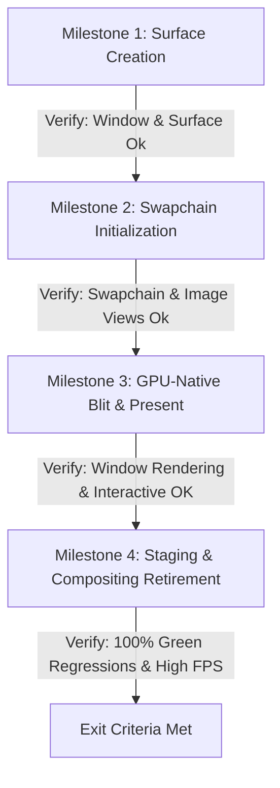

# Vulkan GPU-Native Presentation & Swapchain Integration Plan

This document outlines the step-by-step engineering roadmap to transition the **Vulkan Backend** from its current hybrid CPU-GPU staging presentation model to a **100% GPU-native Unified Framebuffer** using a Vulkan Swapchain, matching the architecture achieved by the OpenGL ES backend.

---

## 1. Architectural Retrospective & Status
During the Phase 5 GLES modernization, we successfully migrated OpenGL ES to a Unified GPU Framebuffer by utilizing `glBlitFramebuffer()` to copy pixels directly from our offscreen FBO to the window surface, entirely bypassing CPU memory during normal rendering.

Currently, **Vulkan remains a Hybrid Backend**:
* **LFB Writes & Reads (Completed)**: Correctly synchronized on-demand between CPU and GPU FBOs using mapped staging memory and per-buffer dirty tracking.
* **Presentation (Hybrid)**: In `SwapBuffers()`, Vulkan performs a costly `copyImageToBuffer` readback of the active GPU FBO to CPU staging memory every frame, overlays CPU writes, and blits it to the window using SDL2's 2D renderer.
* **The "Phase 6 GPU Font Engine" Myth**: Investigation shows that the test console overlay (`tlib` / `tlConRender`) is **already rendered entirely on the GPU** via standard Glide API calls translated to GPU draws. The only reason Vulkan performs CPU-side compositing is because it lacks a native GPU presentation path.

---

## 2. Migration Roadmap (Step-by-Step)

The migration is divided into 4 highly isolated, verifiable milestones. Each milestone must pass its respective verification steps and regression tests before proceeding to the next.



---

### Milestone 1: Vulkan Surface Creation & Instance Extensions
We must enable Vulkan window surface support in our instance and associate it with our SDL2 window.

#### Steps:
1.  **SDL Window Flag**: Update [VulkanBackend.cpp](file:///usr/local/google/home/eianiuk/gemini/3dfx/src/backends/vulkan/VulkanBackend.cpp) inside `Initialize()` to create the SDL window with the `SDL_WINDOW_VULKAN` flag when running in windowed mode.
2.  **Instance Extensions**: Query the Vulkan instance extensions required by SDL2 using `SDL_Vulkan_GetInstanceExtensions()`. Append these extensions to our required extensions list in `CreateInstance()`.
3.  **Surface Creation**: Call `SDL_Vulkan_CreateSurface()` after creating the SDL window to obtain a `VkSurfaceKHR` handle, and store it in the backend.

#### Verification / Exit Criteria:
*   The wrapper compiles successfully.
*   Vulkan instance creation succeeds with the SDL-required extensions enabled.
*   Window creation succeeds in windowed mode.
*   `VkSurfaceKHR` is successfully created (verified via a debug log).
*   **Headless Check**: Verify that headless mode execution is unaffected and runs perfectly (surface creation skipped).

---

### Milestone 2: Swapchain & Image Views Initialization
We must initialize the swapchain and retrieve the presentation images.

#### Steps:
1.  **Device Extension**: Enable the `VK_KHR_swapchain` logical device extension during logical device creation in `CreateLogicalDevice()`.
2.  **Swapchain Creation**: Query surface capabilities, formats, and present modes (`vkGetPhysicalDeviceSurfaceCapabilitiesKHR`, etc.). Create the `VkSwapchainKHR` using the surface format, FIFO present mode (VSync aligned), and swapchain extent (640x480 or 800x600).
3.  **Image Views**: Retrieve the swapchain images using `vkGetSwapchainImagesKHR` and create a `VkImageView` for each image.
4.  **Presentation Semaphores**: Create semaphores (`m_imageAvailableSemaphores` and `m_renderFinishedSemaphores`) to synchronize image acquisition and queue presentation.

#### Verification / Exit Criteria:
*   Logical device creation succeeds with `VK_KHR_swapchain` enabled.
*   Swapchain creation succeeds, allocating 2 or 3 presentation images.
*   Image views and synchronization semaphores are successfully allocated.
*   All resources are properly freed during backend destruction.

---

### Milestone 3: GPU-to-GPU Blit and Swapchain Presentation
We must replace the CPU readback and SDL blit with a direct GPU-to-GPU image copy/present.

#### Steps:
1.  **Acquire Image**: In `SwapBuffers()`, acquire the next available swapchain image index:
    ```cpp
    uint32_t imageIdx;
    m_device->acquireNextImageKHR(m_swapchain.get(), UINT64_MAX, m_imageAvailableSemaphores[m_currentFrameSlot].get(), {}, &imageIdx);
    ```
2.  **Record GPU Blit**: Instead of copying to a CPU staging buffer, record commands to copy our active offscreen FBO image (`m_headlessImages[activeIdx]`) directly to the acquired swapchain image (`m_swapchainImages[imageIdx]`):
    *   Transition swapchain image layout from `Undefined` to `TransferDstOptimal`.
    *   Transition offscreen image layout to `TransferSrcOptimal`.
    *   Call `m_commandBuffer->copyImage` or `m_commandBuffer->blitImage` (performing a **100% GPU-native copy**).
    *   Transition swapchain image layout from `TransferDstOptimal` to `PresentSrcKHR`.
    *   Transition offscreen image layout back to `ColorAttachmentOptimal`.
3.  **Submit & Present**: Submit the command buffer, signaling the `m_renderFinishedSemaphores[m_currentFrameSlot]`. Call `m_graphicsQueue.presentKHR` using the present semaphore.
4.  **Sync Pacing**: Use the swapchain's present queue to regulate pacing, allowing us to drop the CPU-blocking fence waits during windowed SwapBuffers.

#### Verification / Exit Criteria:
*   Interactive windowed mode displays the correct rendering output (e.g. `test11` and `test12` render perfectly).
*   **Zero CPU Readbacks**: Verify via telemetry/profiling that no CPU readbacks or memory-mapped invalidations occur inside `SwapBuffers()`.
*   All visual regression tests (`test00`–`test30`) continue to pass perfectly.

---

### Milestone 4: Staging & Compositing Retirement
Once direct presentation is fully functional, we can safely prune the legacy hybrid workarounds.

#### Steps:
1.  **Remove CPU Blitting**: Completely delete the SDL2 renderer, textures, `SDL_UpdateTexture`, and `SDL_RenderCopy` calls from `VulkanBackend`.
2.  **Prune Staging Resources**: Remove the double-buffered staging buffers (`m_headlessPixelBuffers` / `m_headlessPixelMemories`) from the presentation path. Keep only a single staging buffer dedicated exclusively on-demand to explicit `ReadLFB` calls (frame captures).
3.  **Delete Compositing Loops**: Delete the `cpuRenderingCache` accumulation and overlay loops from `SwapBuffers()`.
4.  **Unified LFB Clears**: Remove any remaining Vulkan-specific alpha-clearing hacks in `ClearBuffer`, returning Vulkan to a solid, 100% opaque rendering state like GLES.

---

## 3. Global Exit Criteria & Verification
The Vulkan Swapchain integration is considered complete when:
1.  **100% Parity**: The entire visual regression matrix (`run_all_tests.py`) passes **100% green** on Vulkan with zero block failures.
2.  **Zero Windowed Blinking**: Interactive windowed mode (`test11`) runs flawlessly with zero startup blinking or initial black/white frames.
3.  **100% GPU-Native Swap**: CPU-GPU readback operations are completely absent from the `SwapBuffers()` hot-path.
4.  **Architecture Alignment**: The Vulkan backend's presentation architecture aligns perfectly with GLES, utilizing direct GPU-to-GPU copies.
